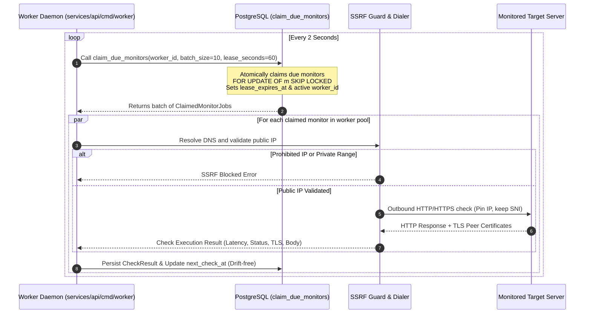

# ClientPulse Architecture Overview

## 1. System Topology

ClientPulse is designed as a **Modular Monolith** with a decoupled background worker process, communicating over a centralized PostgreSQL data store.

```mermaid
graph TD
    User([Agency User / Client Browser]) -->|HTTPS / UI| Web[Next.js Frontend (apps/web)]
    User -->|REST API / HTTPS| Caddy[Caddy / Reverse Proxy]
    Caddy -->|/api/* & /health/*| API[Go API Service (services/api/cmd/api)]
    Caddy -->|/*| Web
    
    API -->|Read / Write Pool / Tenant Context| Postgres[(PostgreSQL 16)]
    Worker[Go Worker Process (services/api/cmd/worker)] -->|Heartbeats / Future Job Loop| Postgres
    Worker -->|Outbound Health / SSL / DNS Checks| ExternalSites[Target Websites / Endpoints]
```

---

## 2. Repository Layout

```text
clientpulse/
├── apps/
│   └── web/                     # Next.js 16+ (App Router), React 19.2, TypeScript, Tailwind CSS
│       ├── src/app/             # Pages: /login, /signup, /onboarding, /organizations, /settings/*
│       └── src/lib/             # api client, auth-context, i18n
├── services/
│   └── api/                     # Go 1.27+ Modular Monolith (API & Worker)
│       ├── cmd/
│       │   ├── api/             # HTTP API entrypoint
│       │   ├── worker/          # Background worker entrypoint
│       │   └── migrate/         # Database migration CLI
│       └── internal/
│           ├── auth/            # Argon2id hashing, CSPRNG tokens, SHA-256 peppered hashing
│           ├── config/          # Environment configuration loading & validation
│           ├── database/        # Connection pool (pgxpool) & ping
│           ├── health/          # Live/Ready/Worker health handlers
│           ├── logger/          # Structured JSON logging with slog & correlation ID
│           ├── mail/            # Email sender interface & SMTP / Mailpit adapter
│           ├── migrate/         # SQL migration engine with advisory locking
│           ├── rate/            # Sliding-window rate limiter
│           ├── repository/      # Models, tenant transactions, RLS integration & repositories
│           ├── server/          # HTTP server, routing, auth & tenant middlewares, handlers
│           ├── service/         # Auth & Organization business domain logic
│           └── tenant/          # TenantContext, UserContext, and RBAC role helpers
├── migrations/                  # Versioned SQL migrations (.up.sql / .down.sql)
├── deploy/                      # Dockerfiles for api, worker, and web
├── docs/                        # Architecture, ADRs, API, security, operations
├── task/                        # Implementation task tracking
├── task-report/                 # Phase execution reports
├── docker-compose.yml           # Local dev orchestrator
├── .env.example                 # Environment variables specification
└── README.md                    # Setup and execution guide
```

---

## 3. Core Modules (services/api/internal/)

| Module | Responsibility |
|---|---|
| `auth` | Argon2id password hashing, CSPRNG tokens, HMAC-SHA256 peppered hashing |
| `config` | Type-safe environment loading and validation |
| `database` | PostgreSQL connection pooling via `jackc/pgx/v5/pgxpool` |
| `health` | Live, Ready, and Worker heartbeat health check probes |
| `logger` | Structured JSON logging using standard `log/slog` with correlation ID |
| `mail` | `EmailSender` interface, SMTP provider (Mailpit in dev), MockMailer for tests |
| `migrate` | Versioned schema migration runner protected by session advisory lock |
| `rate` | Thread-safe sliding window rate limiter |
| `repository` | PostgreSQL data access with `WithTenantTx` and Row-Level Security (RLS) enforcement |
| `server` | HTTP routing, session cookie auth, tenant resolution, RBAC, CSRF, rate limit middlewares |
| `service` | Business logic for Authentication, User Accounts, Organizations, Memberships, and Roles |
| `ssrf` | Multi-layer outbound SSRF protection, IP classification, DNS rebinding defense & socket pinning |
| `checker` | Protocol check engine (HTTP GET/HEAD, SSL certificate lifecycle, JSON Pointer, DNS) |
| `tenant` | TenantContext, UserContext, and RBAC permission evaluation (`HasRole`) |
| `worker` | Monitoring scheduler daemon, atomic job claiming, drift prevention & check persistence |

---

## 4. Monitoring Engine & Scheduler Architecture

ClientPulse implements a distributed, drift-free scheduler using PostgreSQL as the single source of truth:



### 4.1 Atomic Job Claiming (`claim_due_monitors`)
- Stored function defined with `SECURITY DEFINER` and search path restriction (`pg_catalog, public, pg_temp`), owned by restricted non-login role `clientpulse_definer`.
- `EXECUTE` privilege is revoked from `PUBLIC` and `clientpulse_app`, and granted strictly to dedicated login role `clientpulse_worker`.
- Validates parameters strictly inside the function (`1 <= p_batch_size <= 100`, `5 <= p_lease_timeout_seconds <= 3600`, non-empty `p_worker_id`).
- Employs `SELECT ... FOR UPDATE OF m SKIP LOCKED` to allow multiple concurrent worker instances to scale horizontally without duplicate executions.
- Sets an execution lease (`lease_acquired_at = NOW()`, `lease_worker_id = p_worker_id`). Abandoned or crashed jobs whose leases expire are automatically reclaimed by the next available worker.
- Short-lived database transaction: The database connection is held only during the atomic claim query. All network I/O, DNS resolution, and outbound HTTP checks execute outside database transactions.

### 4.2 Drift Prevention & Misfire Policy
- Scheduled check intervals must not drift forward based on slow network latency. The scheduler calculates `next_check_at = scheduled_at + interval`.
- **Misfire Skip Policy:** If a monitor's scheduled time fell significantly behind while the worker was offline or restarting (`next_check_at < NOW()`), the scheduler advances `next_check_at = NOW() + interval` instead of scheduling a stampede of historical catch-up runs.

### 4.3 SSRF Guard & Outbound Connection Pinning
- **DNS Rebinding Defense:** Target hostnames are resolved before connection initiation. Every resolved A and AAAA record is inspected against a comprehensive blacklist of private, loopback, link-local, multicast, CGNAT, and cloud metadata CIDRs.
- **Socket IP Pinning:** The exact public IP address validated by the SSRF guard is passed to `net.Dialer.DialContext`. The outbound TCP connection connects directly to that IP, preventing DNS rebinding race conditions.
- **SNI Preservation:** The original target hostname is preserved in `tls.Config.ServerName` and the HTTP `Host` header for accurate virtual hosting and TLS certificate verification.
- **Redirect Isolation:** The HTTP client validates every HTTP redirect target through the full SSRF pipeline before following. Redirects to internal or prohibited addresses are rejected immediately.
- **Proxy Neutralization:** Custom HTTP transports set `Proxy = nil` to guarantee environment proxy variables do not bypass security controls.

### 4.4 Monitor State Machine & Consecutive Failure Thresholds
- **States:** `pending` (initial), `up` (healthy), `suspected_down` (1 failure), `down` (2+ consecutive failures), `paused` (intentionally disabled), `unknown` (insufficient data).
- **Threshold Rules:**
  - Scheduled check failure with 0 previous failures transitions monitor to `suspected_down` (`consecutive_failures = 1`).
  - Scheduled check failure with 1+ previous failures transitions monitor to `down` (`consecutive_failures = consecutive_failures + 1`).
  - Successful scheduled check transitions monitor to `up` and resets `consecutive_failures = 0`.
  - Manual "Test Now" executions record results as `execution_type = 'manual'` but do not mutate `consecutive_failures` or change scheduled threshold status.

### 4.5 Check Results Retention & Hourly Aggregations
- **Raw Check Results Retention:** Raw entries in `check_results` are retained for a configurable period (`CHECK_RESULT_RETENTION_DAYS`, default 90 days).
- **Bounded Batch Pruning:** Expired check results are deleted in bounded batches (`LIMIT 500`) to avoid table locks and long-running transactions.
- **Hourly Metric Aggregations:** Stored in `check_aggregates_hourly` with rollups for `total_checks`, `successful_checks`, `total_latency_ms`, `min_latency_ms`, and `max_latency_ms`. Aggregates are retained for at least 13 months (400 days) to support historical dashboard reporting and uptime calculation.
