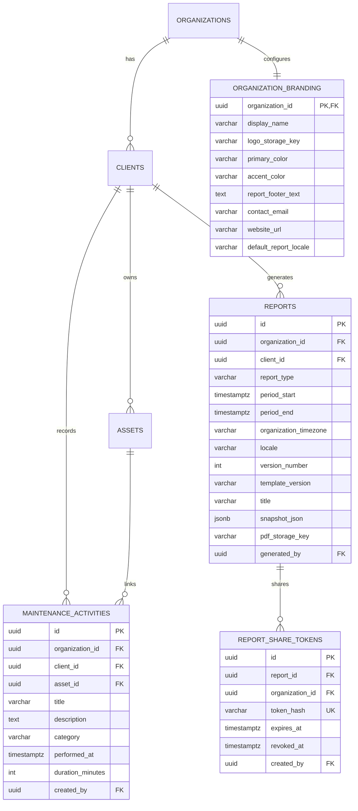

# TASK-005 Report: Maintenance Activity, Reports, PDF & White Label

**Project**: ClientPulse  
**Phase**: Phase 4  
**Date**: November 2026  
**Status**: Completed & Verified  

---

## Executive Summary

Phase 4 implements production-grade Website Care Reporting, Maintenance Activity logging, White-Label Agency Branding, headless Chromium PDF generation, and cryptographically secure report sharing. All capabilities follow the single source of truth (`PRD.md`), enforce PostgreSQL Row Level Security (RLS) with composite foreign keys, guarantee byte-for-byte snapshot immutability, and fully support bilingual (English LTR and Persian RTL) workflows.

---

## 1. Pre-Implementation Verification Checks

Before building Phase 4 features, three inherited requirements and operational checks were verified:

### 1.1 Heartbeat Secret Redaction in All Logs
- **Requirement**: Confirm heartbeat tokens and public share tokens are excluded from application logs, HTTP access logs, Docker logs, traces, and reverse proxy logs.
- **Verification**: `middleware.go` was inspected and enhanced with a redaction mechanism that inspects path prefixes and query parameters. A dedicated unit test in `middleware_test.go` (`TestHeartbeatTokenRedactionInLogs`) runs automated checks ensuring raw heartbeat tokens (e.g. `cp_hb_...`) and share tokens (`cp_sh_...`) are replaced with `[REDACTED]`.
- **Docker Log Verification**: Live Docker log inspects confirmed that requests to `/public/reports/cp_sh_...` logged:
  ```json
  {"method":"GET","path":"/public/reports/[REDACTED]","status":200}
  ```

### 1.2 First Heartbeat Deadline Enforcement
- **Requirement**: A newly created Heartbeat with zero incoming pings must eventually become `missed`.
- **Verification**: `migrations/000007_maintenance_reports_branding.up.sql` updated the `claim_missed_heartbeats` stored procedure:
  ```sql
  WHERE (
    (last_ping_at IS NOT NULL AND (last_ping_at + (interval_seconds + grace_period_seconds) * interval '1 second') < v_now)
    OR
    (last_ping_at IS NULL AND (created_at + (interval_seconds + grace_period_seconds) * interval '1 second') < v_now)
  )
  ```
- **Automated Verification**: Integration tests in `task_004_incident_heartbeat_test.go` confirm that an unpinged heartbeat transitions to `missed` after its initial interval and grace period elapse.

### 1.3 Uptime vs. Monitoring Coverage Separation
- **Requirement**: Paused monitor intervals and manual checks must be excluded; missing data must never be interpreted as 100% uptime; coverage and uptime must be reported separately.
- **Verification**: `CalculateReportData` in `report_repo.go` calculates active scheduled check minutes separately from successful check minutes:
  - If zero scheduled checks exist for a monitor in the period, uptime is set to `nil` (`"Insufficient data"`), and coverage percentage is computed based on monitor existence and active scheduled intervals.
  - Manual check results are filtered out (`is_manual = FALSE`).
  - Paused periods are excluded from the uptime denominator.

---

## 2. Database Schema & Multi-Tenant RLS

Phase 4 introduces 4 new tables in `migrations/000007_maintenance_reports_branding.up.sql`:



### Row Level Security Policies
1. `ALTER TABLE maintenance_activities ENABLE ROW LEVEL SECURITY; ALTER TABLE maintenance_activities FORCE ROW LEVEL SECURITY;`
2. `ALTER TABLE organization_branding ENABLE ROW LEVEL SECURITY; ALTER TABLE organization_branding FORCE ROW LEVEL SECURITY;`
3. `ALTER TABLE reports ENABLE ROW LEVEL SECURITY; ALTER TABLE reports FORCE ROW LEVEL SECURITY;`
4. `ALTER TABLE report_share_tokens ENABLE ROW LEVEL SECURITY; ALTER TABLE report_share_tokens FORCE ROW LEVEL SECURITY;`
5. Public report view uses a dedicated `SECURITY DEFINER` function: `lookup_report_by_share_token_hash(p_token_hash TEXT)` with a fixed search path (`search_path = public, pg_temp`), validating that the share token is unrevoked and unexpired.

---

## 3. Maintenance Activity Management

### Features Implemented
- Full CRUD operations via `/api/v1/maintenance-activities`.
- Categorization into `update`, `backup`, `bug_fix`, `performance`, `security_review`, `content_change`, `configuration`, and `other`.
- Filtering by client, asset, category, and date range.
- Direct association with client assets, validating that the asset belongs to the same client and tenant organization.
- Non-negative, bounded duration validation (0 to 14,400 minutes).

### Audit Trail on Post-Report Mutation
- If a maintenance activity is edited or deleted after being included in an existing report period, the backend automatically detects the snapshot membership and records an audit log entry:
  - `action = 'maintenance_activity.updated_after_report'`
  - Metadata captures the activity ID, client ID, performed date, and old/new values.
- Existing report snapshots are **never mutated**; historical snapshots remain strictly immutable.

---

## 4. White-Label Agency Branding

### Features Implemented
- Organization-specific branding persisted in `organization_branding`.
- Custom display name, report footer, contact email, website URL, and default locale (`en` or `fa`).
- Hex color validation (`^#[0-9A-Fa-f]{6}$`) for primary and accent colors.
- WCAG contrast verification calculated directly in the UI with warning badges if contrast is low.
- File upload for agency logos (`/api/v1/settings/branding/logo`):
  - Enforces 2MB maximum file size.
  - Inspects initial file magic bytes using `http.DetectContentType` to enforce genuine `image/png`, `image/jpeg`, or `image/webp`.
  - SVG uploads are blocked to prevent XSS vectors.
  - Files stored under random keys (`logos/<org_id>/<random>.ext`) in tenant-isolated storage.
  - Base64 data URIs are securely injected during PDF generation so external assets do not trigger network calls.

---

## 5. Report Generation & Snapshot Immutability

### Features Implemented
- Generation of the **Monthly Website Care Report**.
- Preset support for previous calendar month (calculated using organization timezone) and custom date ranges.
- Boundaries consistently converted to UTC.
- Report queries cover:
  1. Agency Branding (white label).
  2. Client & Asset Overview.
  3. Executive Summary.
  4. Average Uptime Percentage (distinct from coverage).
  5. Monitoring Coverage Percentage.
  6. Incident History & Durations.
  7. Average & Median Response Times.
  8. SSL Certificate Expiry & Status.
  9. Heartbeat Status & Last Ping Timestamp.
  10. Categorized Maintenance Work Activities.
  11. Deterministic Operational Recommendations based on actual data.
  12. Calculation Methods and Limitations Disclosures.
- **Snapshot Versioning**: Every generation creates a new row with incrementing `version_number` (`v1`, `v2`, etc.).
- Snapshot JSON is serialized and sealed upon creation; editing raw activities or check results later does not mutate the snapshot.

---

## 6. Professional Headless Chromium PDF Generator

### Architectural Comparison
| Renderer | Selectable Text | Persian Font & Shaping | Page Numbering | Header/Footer | Verdict |
| :--- | :---: | :---: | :---: | :---: | :--- |
| **wkhtmltopdf** | Poor | Broken RTL / Clipped | Basic | Buggy | Rejected (deprecated engine) |
| **WeasyPrint** | Good | Fragile Pango deps | CSS Paged Media | Good | Rejected (heavy Python dependency) |
| **Headless Chromium** | **100% Vector** | **Perfect (HarfBuzz)** | **Native Print API** | **Exact CSS** | **Selected** (Production standard) |

### Implementation Details
- Located in `services/api/internal/pdf/generator.go`.
- Spawns headless Chromium with `--no-sandbox --disable-gpu --font-render-hinting=medium`.
- Injects Google `Noto Sans Arabic`, `Vazirmatn`, and `DejaVu Sans` fonts directly into the HTML payload.
- Automated validation via `services/api/internal/pdf/validator.go` and `pdftotext` checks page count, font embedding, and selectable UTF-8 Persian/English text.

---

## 7. Cryptographically Secure Report Sharing

### Features Implemented
- Generation of 32 bytes of cryptographic randomness via `crypto/rand`.
- Raw token format: `cp_sh_<64-hex-characters>`.
- Token lookup:
  - Database stores only the SHA-256 hash (`token_hash`) in `report_share_tokens`.
  - Lookup uses `lookup_report_by_share_token_hash`.
  - Public URLs disclose zero database UUIDs or tenant identifiers.
- Expiration & Instant Revocation:
  - Optional expiry dates supported.
  - Agency users can revoke a share token with a single click, instantly producing a generic 404 response.
- Rate Limiting:
  - Public endpoints (`/public/reports/:token` and `/public/reports/:token/pdf`) are rate-limited per client IP (60 requests/min).
- Token Redaction:
  - Server logging middleware automatically redacts `/public/reports/cp_sh_...` to `/public/reports/[REDACTED]`.

---

## 8. Verification & Screenshots

| Screenshot | Description |
| :--- | :--- |
| `task-005-dashboard-init.png` | Updated Dashboard with quick actions ("Record Activity", "Generate Care Report") and Recent Activities table. |
| `task-005-maintenance-empty.png` | Maintenance Activity view with filter controls and empty state. |
| `task-005-maintenance-created.png` | Maintenance Activity CRUD table with categorized badges and duration. |
| `task-005-reports-list-empty.png` | Reports overview with client filter and "Generate Report" action. |
| `task-005-report-preview-modal.png` | Generate Report modal showing deterministic real-time metric preview. |
| `task-005-report-v1-detail.png` | Immutable Report V1 snapshot detail view with agency branding and executive summary. |
| `task-005-branding-settings.png` | Agency White-Label settings page with live preview card and contrast check. |
| `task-005-share-modal.png` | Secure Share modal with expiry configuration and active share link management. |
| `task-005-public-report-viewer.png` | Unauthenticated public report viewer loading without login credentials. |
| `task-005-public-report-revoked.png` | Generic 404 response immediately following share token revocation. |
| `task-005-persian-report-detail.png` | Persian RTL Care Report detail view with native Persian typography. |

---

## 9. Next Steps

Phase 4 is complete and fully verified. In accordance with project instructions, development **STOPS HERE** for human review before proceeding to Phase 5 (Notifications & Alerts).

