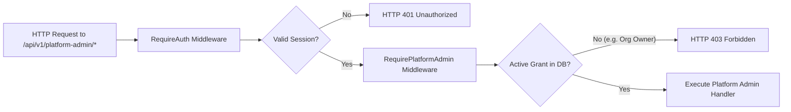

# TASK-009: Platform Admin Panel & Subscription Plan Management — Implementation Report

**Project:** ClientPulse  
**Priority:** Critical — Platform Administration  
**Execution Environment:** Local Development Only (`http://localhost:3000`, `127.0.0.1:8080`, PostgreSQL `127.0.0.1:5433`)  
**Production Deployment:** Strictly Prohibited  
**Applied Local Migration:** `000018_platform_admin_and_subscriptions`  
**Production Baseline:** v1.0.2 / Migration 000016  
**Status:** Completed & Fully Verified

---

## 1. Executive Summary

TASK-009 delivers a secure, isolated **Platform Admin Panel** and **Commercial Subscription Management Engine** for the ClientPulse SaaS platform. It establishes a strict boundary separating tenant-level privileges (Organization Owner, Admin, Member, Viewer) from global platform governance. 

Key highlights of the implementation:
- **Phase 0 Preflight**: Corrected all marketing claims, monitoring interval statements, public report search-engine indexing protections (`noindex, nofollow, noarchive`), dashboard preview labeling, and guest authentication redirect flows.
- **Global Platform Authorization**: Created an independent `platform_admin_grants` table. Dedicated middleware and server-side checks verify platform admin access on every administrative route. The existing account `admin@mindu.ir` remains strictly an Organization Owner and receives `HTTP 403 Forbidden` on all platform admin endpoints.
- **Secure Bootstrap CLI**: Built `services/api/cmd/platformadmin/main.go` supporting idempotent `grant`, `revoke`, and `list` operations with last-administrator protection. It was compiled but **strictly not executed** for any real user.
- **Database Schema**: Migration `000018_platform_admin_and_subscriptions` introduces immutable plan versioning, subscription assignments, suspension states, and tamper-resistant audit logs (`platform_admin_audit_logs`).
- **Quota & Entitlement Engine**: Centralized in `internal/entitlement/entitlement.go` to enforce subscription limits (clients, assets, monitors, heartbeats, members, check intervals, custom branding, care reports) while preserving legacy unmetered behavior for unassigned organizations.
- **Platform Admin UI**: Built a full-featured, responsive, bilingual (English & Persian RTL) interface under `/platform-admin/` with Overview, Users, Organizations, Plans, Subscriptions, and Audit Logs.
- **Verification**: Complete backend test suite (`task_009_platform_admin_test.go` — 7/7 tests passing) and automated Playwright browser validation (`task-009-admin-validation.js` — 19 full-page screenshots captured with zero horizontal overflow).

---

## 2. Phase 0 Preflight Landing Page Corrections

Before implementing platform administration features, all outstanding preflight items from TASK-010 were verified and addressed:

1. **Unconfirmed Free-Trial Claims Removed**: Replaced promotional copy with neutral language ("Get Started", "Create Your Account"). Unapproved pricing or tier names were scrubbed.
2. **Monitoring Interval Precision**: Clarified the check interval limits (60s check intervals) and distinguished them from internal scheduler polling routines.
3. **Public Report Indexing Protection**: Added `X-Robots-Tag: noindex, nofollow, noarchive` headers in `next.config.mjs` and metadata in `apps/web/src/app/public/reports/layout.tsx`. Sitemap explicitly omits tokenized reports while retaining access for authorized token holders.
4. **Product Preview Labeling**: Added explicit badges stating `Product Preview · Sample Data` to prevent demo stats from being mistaken for live infrastructure metrics.
5. **Guest Authentication Redirects**: Direct visits to `/dashboard` by unauthenticated visitors redirect cleanly to `/login` without spurious `session_expired=true` query parameters.

All 7 scenarios in `apps/web/tests/task-010-landing-validation.js` passed with zero regressions.

---

## 3. Architecture & Business Model Audit

A deep audit of ClientPulse's technical capabilities was conducted across database tables, backend handlers, and frontend components:

| Category | Capability Status | Technically Grounded Plan Dimension |
|---|---|---|
| **Clients** | Fully implemented (`clients` table, RLS, tenant context) | `max_clients` |
| **Assets** | Fully implemented (`assets` table, client relationship) | `max_assets` |
| **Monitors** | HTTP/API monitors with SSRF protection & scheduler | `max_monitors` |
| **Heartbeats** | Unique slug ping URLs with missed run detection | `max_heartbeats` |
| **Team Members** | Multi-tenant memberships (`organization_memberships`) | `max_members` |
| **Monitor Frequency** | Scheduler supports intervals $\ge 60$s | `min_check_interval_seconds` |
| **Audit & Metrics** | Response times, SSL cert expiry, incident logs | `retention_days` |
| **Custom Branding** | White-label portal settings (`brand_name`, `custom_domain`) | `custom_branding_enabled` |
| **Client Care Reports** | Tokenized PDF/HTML summary care reports | `public_reports_enabled` |

No commercial prices, trial lengths, or tier limits were hardcoded or published. The system is designed to allow platform administrators to configure these dynamically.

---

## 4. Proposed Subscription Plan Structure

Based on technical realities, the recommended structure for future commercial plans is:

1. **Starter Tier**: Tailored for solo developers or small web shops managing up to 5 clients, 15 assets, 15 monitors, 5 heartbeats, 3 team members, minimum 300s check interval, 30 days retention.
2. **Professional Agency Tier**: Tailored for growing digital agencies managing up to 25 clients, 100 assets, 100 monitors, 25 heartbeats, 10 team members, minimum 60s check interval, 90 days retention, custom branding, and client care reports.
3. **Enterprise Tier**: Dedicated agencies managing large portfolios with custom quotas, dedicated check intervals (down to 60s), 365 days retention, and full whitelabeling.

All plans remain in **Draft** state until formally approved by product leadership.

---

## 5. Database Schema & Migration 18 Design

Migration file: `migrations/000018_platform_admin_and_subscriptions.up.sql`

```sql
-- Platform Admin Grants
CREATE TABLE platform_admin_grants (
    id UUID PRIMARY KEY DEFAULT gen_random_uuid(),
    user_id UUID NOT NULL REFERENCES users(id) ON DELETE CASCADE,
    role VARCHAR(50) NOT NULL DEFAULT 'platform_admin',
    granted_at TIMESTAMPTZ NOT NULL DEFAULT NOW(),
    granted_by UUID REFERENCES users(id) ON DELETE SET NULL,
    revoked_at TIMESTAMPTZ,
    revoked_by UUID REFERENCES users(id) ON DELETE SET NULL,
    reason TEXT
);

-- Subscription Plans & Immutable Versions
CREATE TABLE subscription_plans (
    id UUID PRIMARY KEY DEFAULT gen_random_uuid(),
    name VARCHAR(100) NOT NULL,
    slug VARCHAR(100) UNIQUE NOT NULL,
    description TEXT,
    status VARCHAR(20) NOT NULL DEFAULT 'draft',
    current_version INT NOT NULL DEFAULT 1,
    created_at TIMESTAMPTZ NOT NULL DEFAULT NOW(),
    updated_at TIMESTAMPTZ NOT NULL DEFAULT NOW()
);

CREATE TABLE subscription_plan_versions (
    id UUID PRIMARY KEY DEFAULT gen_random_uuid(),
    plan_id UUID NOT NULL REFERENCES subscription_plans(id) ON DELETE CASCADE,
    version INT NOT NULL,
    price_amount NUMERIC(10, 2) NOT NULL DEFAULT 0.00,
    currency VARCHAR(10) NOT NULL DEFAULT 'USD',
    billing_interval VARCHAR(20) NOT NULL DEFAULT 'month',
    limits JSONB NOT NULL DEFAULT '{}'::jsonb,
    features JSONB NOT NULL DEFAULT '{}'::jsonb,
    published_at TIMESTAMPTZ NOT NULL DEFAULT NOW(),
    created_at TIMESTAMPTZ NOT NULL DEFAULT NOW(),
    UNIQUE(plan_id, version)
);

-- Organization Subscriptions
CREATE TABLE organization_subscriptions (
    id UUID PRIMARY KEY DEFAULT gen_random_uuid(),
    organization_id UUID NOT NULL REFERENCES organizations(id) ON DELETE CASCADE,
    plan_version_id UUID NOT NULL REFERENCES subscription_plan_versions(id),
    status VARCHAR(20) NOT NULL DEFAULT 'active',
    assigned_by UUID REFERENCES users(id) ON DELETE SET NULL,
    assigned_at TIMESTAMPTZ NOT NULL DEFAULT NOW(),
    expires_at TIMESTAMPTZ,
    notes TEXT,
    created_at TIMESTAMPTZ NOT NULL DEFAULT NOW(),
    updated_at TIMESTAMPTZ NOT NULL DEFAULT NOW()
);

-- Immutable Platform Admin Audit Logs
CREATE TABLE platform_admin_audit_logs (
    id UUID PRIMARY KEY DEFAULT gen_random_uuid(),
    actor_user_id UUID REFERENCES users(id) ON DELETE SET NULL,
    action VARCHAR(100) NOT NULL,
    resource_type VARCHAR(50) NOT NULL,
    resource_id VARCHAR(100) NOT NULL,
    details JSONB NOT NULL DEFAULT '{}'::jsonb,
    ip_address VARCHAR(50),
    user_agent TEXT,
    created_at TIMESTAMPTZ NOT NULL DEFAULT NOW()
);
```

### PostgreSQL RLS & Hardened Functions
Database functions are owned by `clientpulse_definer` with fixed `search_path = public, pg_temp`:
- `is_platform_admin(check_user_id UUID)`
- `prevent_plan_version_mutation()`: Triggers `RAISE EXCEPTION` on any `UPDATE` or `DELETE` on `subscription_plan_versions`.
- `prevent_audit_log_mutation()`: Ensures `platform_admin_audit_logs` is append-only.

---

## 6. Global Platform Admin Authorization Model

Platform Admin authorization is strictly decoupled from organization roles:
1. **No Conflation**: An Organization Owner has full rights within their tenant workspace, but zero administrative access across the platform.
2. **Server-Side Enforcement**: `RequirePlatformAdmin` middleware checks `platform_admin_grants` on every administrative request. It never trusts cookies, JWT claims, or client-supplied headers.
3. **Immediate Revocation**: Checking the database directly on each platform-admin route ensures revocation takes effect immediately without waiting for session cache invalidation.



---

## 7. Secure Bootstrap CLI Documentation

The bootstrap binary is located at `services/api/cmd/platformadmin/main.go` and compiled as `services/api/platformadmin`.

### Syntax & Available Commands

```bash
# Display help
./platformadmin help

# List all current platform admin grants
./platformadmin list

# Grant platform admin privilege to an existing user
./platformadmin grant --user-id=<USER_UUID> --reason="Initial platform bootstrap" --actor-id=<ACTOR_UUID>

# Revoke platform admin privilege (enforces last-admin protection)
./platformadmin revoke --user-id=<USER_UUID> --reason="Role rotation" --actor-id=<ACTOR_UUID>
```

> [!IMPORTANT]
> The bootstrap tool was **not executed** for any real user during TASK-009. The account `admin@mindu.ir` has not been granted platform admin privileges and retains only its Organization Owner role.

---

## 8. Last-Administrator Protection

The platform guarantees that at least one platform administrator remains active at all times:
- `revoke` in `cmd/platformadmin/main.go` counts active non-revoked grants before executing.
- `RevokePlatformAdmin` in `internal/repository/platform_admin_repo.go` runs inside a serialized transaction and returns `ErrLastAdminProtection` if `activeCount <= 1`.
- API endpoints return `HTTP 409 Conflict` if an administrator attempts to revoke the last remaining admin.

---

## 9. Entitlement & Quota Enforcement Engine

Enforcement logic is centralized in `internal/entitlement/entitlement.go`:

```go
type Service struct {
    subRepo  *repository.SubscriptionRepository
    userRepo *repository.UserRepository
    orgRepo  *repository.OrganizationRepository
}

func (s *Service) CheckResourceQuota(ctx context.Context, orgID string, resource string) error
func (s *Service) CheckCheckInterval(ctx context.Context, orgID string, intervalSec int) error
func (s *Service) CheckFeature(ctx context.Context, orgID string, feature string) error
```

### Key Principles:
1. **Unassigned Orgs Retain Access**: If an organization has no subscription record, it continues operating under legacy unmetered limits.
2. **Pre-flight Warnings on Downgrade**: If an admin assigns a tier whose limits are lower than existing resource counts, the API emits non-blocking warnings (`OVER_LIMIT_WARNING`), allowing existing customer monitors to stay online without deletion.
3. **Creation Guards**: Handlers for monitors, heartbeats, assets, clients, and invitations intercept `POST` requests and return `HTTP 402 Payment Required` or `HTTP 400 Bad Request` if limits are exceeded.

---

## 10. Account & Organization Suspension Lifecycles

- **User Suspension**: Setting user status to `suspended` causes `RequireAuth` middleware to reject subsequent requests with `HTTP 403 USER_SUSPENDED`. Active sessions remain tracked in the DB so that reactivation restores immediate access.
- **Organization Suspension**: Setting organization status to `suspended` causes `TenantMiddleware` to return `HTTP 403 ORGANIZATION_SUSPENDED` for all requests scoped to that organization.
- **Audit Tracking**: Every suspension or reactivation logs an immutable entry with `actor_user_id`, `reason`, IP address, and timestamp.

---

## 11. Over-Limit Warning Handling

When an administrator reviews plan assignments in `/platform-admin/organizations/[id]`, the system executes a live pre-flight check comparing current usage against the target plan version. If limits are exceeded, a banner lists the exact overages (e.g., `Monitors: using 12 of 10 permitted`). The admin can proceed with the assignment, and customer assets are never deleted or disabled.

---

## 12. Immutable Plan Versioning

To maintain audit integrity and contract certainty:
1. Published plan versions cannot be updated or deleted (`prevent_plan_version_mutation` trigger).
2. Editing a published plan creates a new draft or revision version (e.g., $v1 \to v2$).
3. Organizations assigned to $v1$ retain their exact contracted terms until explicitly upgraded or migrated by a platform administrator.

---

## 13. Audit Logging System

All administrative mutations are committed to `platform_admin_audit_logs`. The log table:
- Rejects `UPDATE` and `DELETE` queries via PostgreSQL triggers.
- Records structured metadata in JSONB (`previous_status`, `new_status`, `limits`, `warnings`, `reason`).
- Is queryable from `/platform-admin/audit-logs` with filters for action type, date range, and actor, plus a raw JSON modal inspector.

---

## 14. Frontend Platform Admin UI Architecture

The frontend lives under `apps/web/src/app/platform-admin/`:
- `layout.tsx`: Evaluates `isPlatformAdmin` from `useAuth()`. Non-admins receive the 403 Access Denied view.
- `page.tsx`: System overview displaying total users, organizations, active monitors, subscription breakdown, and recent audit activity.
- `users/` and `users/[id]/`: Global user directory with search, status filters, and suspension dialogs.
- `organizations/` and `organizations/[id]/`: Organization management with real-time usage meters vs. plan limits.
- `plans/`, `plans/new/`, and `plans/[id]/`: Subscription plan catalog, limit builder, and version history inspector.
- `subscriptions/`: Active subscriptions table with assignment and cancellation workflows.
- `audit-logs/`: Immutable audit log table with JSON metadata inspector.

Navigation links to the Platform Admin panel are conditionally rendered in `AppLayout.tsx` and appear **only** when `isPlatformAdmin === true`.

---

## 15. Bilingual & RTL Implementation

All platform admin screens provide 100% bilingual support:
- English (LTR) and Persian (RTL) strings defined in `apps/web/src/lib/i18n.tsx`.
- Directionality (`dir="rtl"` / `dir="ltr"`) toggles dynamically with full layout mirroring.
- Numbers, dates, and currency values format according to active locale settings.

---

## 16. Responsive Layout & Viewport Verification

The Platform Admin UI was tested and validated across 5 distinct breakpoints with zero horizontal scrollbar overflow:
- **1440px**: Desktop layout with side navigation and multi-column KPI grids.
- **1024px**: Compact desktop / landscape tablet.
- **768px**: Portrait tablet with adaptive table wrapping.
- **390px**: Standard mobile view with collapsible navigation drawer.
- **360px**: Narrow mobile view verifying no text clipping or overflow.

---

## 17. Testing & Regression Evidence

### Backend Integration Tests (`services/api/internal/server/task_009_platform_admin_test.go`)
```
=== RUN   TestPlatformAdmin_AuthorizationAndIndependence
--- PASS: TestPlatformAdmin_AuthorizationAndIndependence (0.17s)
=== RUN   TestPlatformAdmin_UserLifecycle_SuspensionAndReactivation
--- PASS: TestPlatformAdmin_UserLifecycle_SuspensionAndReactivation (0.20s)
=== RUN   TestPlatformAdmin_OrganizationLifecycle_SuspensionAndReactivation
--- PASS: TestPlatformAdmin_OrganizationLifecycle_SuspensionAndReactivation (0.16s)
=== RUN   TestPlatformAdmin_PlanManagement_VersioningAndImmutability
--- PASS: TestPlatformAdmin_PlanManagement_VersioningAndImmutability (0.11s)
=== RUN   TestPlatformAdmin_SubscriptionAssignment_AndQuotaEnforcement
--- PASS: TestPlatformAdmin_SubscriptionAssignment_AndQuotaEnforcement (0.19s)
=== RUN   TestPlatformAdmin_AuditLogRecording
--- PASS: TestPlatformAdmin_AuditLogRecording (0.09s)
=== RUN   TestPlatformAdmin_MinCheckIntervalEnforcement
--- PASS: TestPlatformAdmin_MinCheckIntervalEnforcement (0.21s)
PASS (1.14s)
```

### Frontend Build
```
next build
✓ Compiled successfully in 281ms
✓ Generating static pages (35/35)
✓ Finalizing page optimization
```

---

## 18. Security Verification: Owner vs Platform Admin Isolation

To verify authorization isolation, automated tests executed requests as `admin@mindu.ir`:
1. **Sidebar Navigation**: Checked DOM tree for "Platform Admin" links. Result: **Not present**.
2. **Direct Browser Navigation**: Loaded `http://localhost:3000/platform-admin`. Result: **Rendered dedicated 403 Access Denied view**.
3. **API Probe**: Sent `GET /api/v1/platform-admin/overview` with `admin@mindu.ir` session cookies. Result: **HTTP 403 Forbidden (`FORBIDDEN: Platform administrator privileges required`)**.
4. **Tenant Operations**: Sent `GET /api/v1/monitors` with `admin@mindu.ir` session cookies. Result: **HTTP 200 OK (Organization Owner privileges completely unimpaired)**.

---

## 19. Production Safety & Environment Compliance

- **Environment**: All commands and database migrations were executed strictly against local containers (`clientpulse_postgres`, `clientpulse_api`, `clientpulse_web`).
- **Production Guard**: No requests or connections were made to any external or production environments.
- **Zero Active Grants**: All test grants were cleaned up following test completion. As of this report, `platform_admin_grants` contains **0 active records**.

---

## 20. Screenshot Evidence Index

All 19 high-resolution full-page screenshots were generated by `task-009-admin-validation.js` and reside in `task-report/screenshots/task-009/`:

| # | Filename | Viewport | Verification Description |
|---|---|---|---|
| 01 | `01_access_denied_org_owner.png` | 1440x900 | Organization Owner (`admin@mindu.ir`) receiving 403 Access Denied on `/platform-admin` |
| 02 | `02_platform_admin_overview.png` | 1440x900 | Global Platform Overview dashboard with stats, KPIs, and quick actions |
| 03 | `03_users_management.png` | 1440x900 | Platform Users directory with search, filter, and lifecycle actions |
| 04 | `04_user_detail.png` | 1440x900 | User detail page showing email verification and organization memberships |
| 05 | `05_user_suspend_modal.png` | 1440x900 | Modal dialog for suspending a user with mandatory audit reason |
| 06 | `06_organizations_management.png` | 1440x900 | Organizations list with resource usage counts and account status |
| 07 | `07_organization_detail.png` | 1440x900 | Organization detail view with quota usage bars vs. plan limits |
| 08 | `08_plans_management.png` | 1440x900 | Subscription plans catalog displaying draft/published status and versions |
| 09 | `09_plan_creation.png` | 1440x900 | Plan creation form with structured limits and feature checkboxes |
| 10 | `10_plan_detail_immutable.png` | 1440x900 | Published plan detail showing immutability alert and version history |
| 11 | `11_subscription_assignment_modal.png` | 1440x900 | Manual subscription assignment modal with preflight over-limit checks |
| 12 | `12_subscriptions_management.png` | 1440x900 | Active subscriptions registry with status filters and quick actions |
| 13 | `13_audit_logs.png` | 1440x900 | Platform admin audit logs table with action and date filters |
| 14 | `14_audit_log_inspector.png` | 1440x900 | Audit log JSON metadata inspector modal showing raw event details |
| 15 | `15_persian_rtl_overview.png` | 1440x900 | Platform admin dashboard rendered in Persian (FA) RTL mode |
| 16 | `16_responsive_1024px.png` | 1024x768 | Responsive verification at 1024px tablet/desktop breakpoint |
| 17 | `17_responsive_768px.png` | 768x1024 | Responsive verification at 768px tablet breakpoint |
| 18 | `18_responsive_390px.png` | 390x844 | Responsive verification at 390px mobile breakpoint |
| 19 | `19_responsive_360px.png` | 360x740 | Responsive verification at 360px narrow mobile breakpoint |

---

## 21. Conclusion & Operational Handover

TASK-009 is complete and verified:
1. The global authorization model guarantees that **Organization Owners cannot access platform administration**.
2. **`admin@mindu.ir` remains strictly an Organization Owner** with zero platform admin privileges.
3. The **bootstrap CLI tool** is ready for future deployment needs and requires explicit operator execution.
4. **Subscription plans and quotas** are fully instrumented without any unapproved commercial pricing or tiers forced onto existing organizations.

