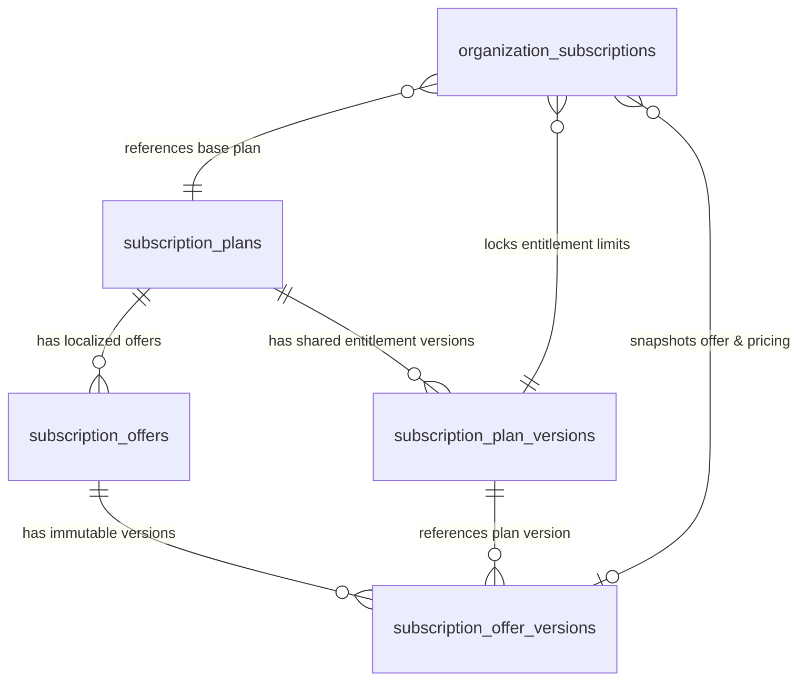

# TASK-009.3 Implementation Report: Platform Admin Redesign & Locale-Aware Subscription Catalog

**Project:** ClientPulse  
**Priority:** Critical — Product Administration & Commercial Architecture  
**Execution Environment:** Local Development Only  
**Production Deployment:** Strictly Prohibited (Untouched)  
**Related Tasks:** TASK-009, TASK-009.1, TASK-009.2, TASK-010  
**Date:** 2026-11-04  
**Status:** Completed & Verified  

---

## 1. Initial Architecture Audit (Phase 0)

### 1.1 Existing Platform Admin Route Structure
The existing Platform Admin routes in `apps/web/src/app/platform-admin/` include:
- `/platform-admin`: Platform Dashboard / Overview
- `/platform-admin/users`: Users list
- `/platform-admin/users/[id]`: User details and suspension controls
- `/platform-admin/organizations`: Organizations list
- `/platform-admin/organizations/[id]`: Organization detail, resource usage, subscription assignment
- `/platform-admin/plans`: Subscription plans list
- `/platform-admin/plans/new`: Create plan wizard
- `/platform-admin/plans/[id]`: Plan detail, version history, publishing, and archiving
- `/platform-admin/subscriptions`: Subscription lifecycle view
- `/platform-admin/audit-logs`: Platform admin audit log records

### 1.2 Layout & Application Shell Audit
- `AppLayout.tsx` provides the primary ClientPulse application shell with responsive sidebar, header, active workspace switcher, user profile menu, and RTL/LTR direction switching.
- Platform Admin previously used an ad-hoc layout disconnected from the polished look of the main application.
- The sidebar in `AppLayout.tsx` displays navigation items based on `isPlatformAdmin` grant checks.

### 1.3 Localization & i18n Audit
- The web app uses `apps/web/src/lib/i18n.tsx`.
- Locales defined: `"en"` (English) and `"fa"` (Persian).
- Locale persistence: `localStorage.getItem("clientpulse_locale")`.
- The established Persian locale identifier across ClientPulse is `"fa"`. To preserve compatibility with existing preferences and database records, `"fa"` is retained as the standard locale identifier.

### 1.4 Subscription Plans & Pricing Model Audit
- Migration `000018` introduced `subscription_plans`, `subscription_plan_versions`, `organization_subscriptions`, and `platform_admin_audit_logs`.
- Migration `000019` hardened plan versions to make published versions immutable, allow drafts to have null/unconfigured prices, and restrict foreign key cascades.
- Previously, each `subscription_plan_version` conflated technical quota limits (`max_clients`, `max_monitors`, etc.) with pricing (`price_amount`, `currency`, `billing_interval`). There was no support for localized plan descriptions, titles, or market-specific currencies and display denominations.
- `IRR` is registered as ISO 4217. Toman is an Iranian market display denomination, not an ISO currency code.

### 1.5 Database Migrations
- Migrations `000001` through `000019` were applied locally and preserved without modification.
- Migration `000020_locale_settings_and_localized_catalogs` was created and applied to introduce the central localization configuration and localized offer architecture.

---

## 2. New Language-Management Architecture

Global localization settings are centrally governed by Platform Admin and stored in PostgreSQL as the single source of truth.

### Relational Table: `platform_localization_settings`
```sql
CREATE TABLE IF NOT EXISTS platform_localization_settings (
    id INT PRIMARY KEY DEFAULT 1,
    enabled_locales TEXT[] NOT NULL DEFAULT ARRAY['en', 'fa'],
    default_locale VARCHAR(16) NOT NULL DEFAULT 'en',
    created_at TIMESTAMPTZ NOT NULL DEFAULT NOW(),
    updated_at TIMESTAMPTZ NOT NULL DEFAULT NOW(),
    updated_by UUID REFERENCES users(id) ON DELETE SET NULL,
    CONSTRAINT chk_singleton_row CHECK (id = 1),
    CONSTRAINT chk_default_in_enabled CHECK (default_locale = ANY(enabled_locales)),
    CONSTRAINT chk_at_least_one_enabled CHECK (array_length(enabled_locales, 1) >= 1)
);
```

### In-Memory Cache with PostgreSQL Source of Truth
- `LocalizationRepository` in `services/api/internal/repository/localization_repo.go` caches the active settings in memory with a read-write lock (`sync.RWMutex`).
- Cache invalidation occurs automatically on every administrative update via `UpdateSettings(ctx, actorID, ...)`.
- Mutating operations acquire row-level locks (`SELECT ... FOR UPDATE`) to prevent race conditions during concurrent administrative updates.

---

## 3. Enabled/Disabled Language Behavior

1. **Public Discovery:**
   - The endpoint `GET /api/v1/public/localization` returns `enabled_locales`, `default_locale`, and metadata for supported locales (labels, text directions, active flags).
   - Unauthenticated visitors, landing pages, and login views use this endpoint to hide disabled languages.
2. **Language Switchers:**
   - In `apps/web/src/components/AppLayout.tsx` and `apps/web/src/lib/i18n.tsx`, language switchers are conditionally rendered only when multiple locales are enabled.
   - If only one language is enabled, the switcher is hidden automatically.
3. **Graceful Fallback:**
   - When a language is disabled by Platform Admin, existing authenticated users or public visitors whose saved locale is disabled automatically fall back to the platform `default_locale`.
   - Existing authenticated sessions, organization subscriptions, and historical logs are never terminated or corrupted because a locale is disabled.

---

## 4. Default Locale and Fallback Behavior

1. **Validation Invariants:**
   - At least one language must remain enabled at all times.
   - The configured default language must always be one of the enabled languages.
   - The current default language cannot be disabled without first designating another enabled language as the default.
2. **Server-Side Enforcement:**
   - Validated both in PostgreSQL check constraints (`chk_default_in_enabled`, `chk_at_least_one_enabled`) and in Go repository business logic (`ErrDefaultLocaleDisabled`, `ErrCannotDisableLastLocale`).
3. **Client Resolution:**
   - `I18nProvider` in `apps/web/src/lib/i18n.tsx` listens to centralized public settings. If `clientpulse_locale` in `localStorage` references an inactive locale, it updates state to `defaultLocale` without data loss.

---

## 5. Locale-Aware Subscription Data Model

Subscription catalogs are decoupled into base plans (technical capabilities) and localized offers (pricing and presentation).

### Relational Schema



### Table: `subscription_offers`
- `id` (UUID, PK)
- `plan_id` (UUID, FK -> `subscription_plans`)
- `locale` (VARCHAR(16), e.g. `'en'`, `'fa'`)
- `market` (VARCHAR(32), e.g. `'global'`, `'ir'`)
- `name` (VARCHAR(255), localized title)
- `description` (TEXT, localized summary)
- `features_summary` (JSONB, array of bullet points)
- `status` (VARCHAR(32): `'draft'`, `'published'`, `'archived'`)
- Unique constraint: `(plan_id, locale, market)`

---

## 6. Shared Plan Entitlement Model

Technical quotas and capabilities are defined on the base plan version:
- `max_clients`
- `max_assets`
- `max_monitors`
- `max_heartbeats`
- `max_members`
- `min_check_interval_seconds`
- `retention_days`
- `custom_branding_enabled`
- `public_reports_enabled`

These entitlements remain identical across English and Persian offers for the same plan version. Modifying pricing in the Persian catalog does not alter English pricing, nor does it affect base plan quota limits.

---

## 7. Localized Offer Versioning & Immutability

### Table: `subscription_offer_versions`
- `id` (UUID, PK)
- `offer_id` (UUID, FK -> `subscription_offers`)
- `plan_version_id` (UUID, FK -> `subscription_plan_versions`)
- `version` (INT, monotonically increasing)
- `status` (VARCHAR(32): `'draft'`, `'published'`, `'archived'`)
- `price_amount` (BIGINT, stored canonical price in minor units: cents or Rials)
- `currency` (VARCHAR(3), ISO 4217: `USD`, `IRR`)
- `display_denomination` (VARCHAR(32): `'usd'`, `'toman'`, etc.)
- `denomination_ratio` (BIGINT, integer conversion ratio, default `10` for Toman)
- `billing_interval` (VARCHAR(32), e.g. `'monthly'`, `'yearly'`)
- `published_at` (TIMESTAMPTZ)
- `published_by` (UUID, FK -> `users`)

### PostgreSQL Immutability Trigger
```sql
CREATE OR REPLACE FUNCTION prevent_offer_version_mutation()
RETURNS TRIGGER AS $$
BEGIN
    IF OLD.status = 'published' THEN
        RAISE EXCEPTION 'published subscription offer versions are immutable and cannot be updated or deleted';
    END IF;
    RETURN NEW;
END;
$$ LANGUAGE plpgsql;

CREATE TRIGGER trg_immutable_published_offer_versions
BEFORE UPDATE OR DELETE ON subscription_offer_versions
FOR EACH ROW EXECUTE FUNCTION prevent_offer_version_mutation();
```

---

## 8. Currency and Toman Denomination Model

- **ISO Standard Currency:** Iranian market pricing strictly uses ISO 4217 currency code `IRR` (Iranian Rial) as the canonical stored currency.
- **Display Denomination:** Display denomination is stored as `'toman'` (`تومان`).
- **Denomination Ratio:** Denomination ratio is stored as integer `10` (1 Toman = 10 Rials).
- **Administrative Transparency:** The Platform Admin plan editor accepts pricing in Toman while explicitly displaying the canonical Rial calculation:
  - Input: `290,000` Toman
  - Preview: `۲۹۰٬۰۰۰ تومان / ماه`
  - Stored canonical amount: `2,900,000` IRR (ratio 10)

---

## 9. Conversion and Rounding Details

All monetary math uses 64-bit integer arithmetic. Floating-point calculations are strictly prohibited in the monetary conversion pipeline:
- **Canonical Calculation:**
  $$\text{canonicalPrice} = \text{displayPrice} \times \text{ratio}$$
- **Integer Overflow Protection:**
  Checked before multiplication via `displayPrice > math.MaxInt64 / ratio`.
- **Display Formatting:**
  `FormatDisplayPrice` formats English amounts using USD cents-to-dollars (`$29.00 / month`) and Persian amounts using integer Toman with Persian numerals and thousand separators (`۲۹۰٬۰۰۰ تومان / ماه`).

---

## 10. Database Migration Details

- Migration `000020_locale_settings_and_localized_catalogs.up.sql` applied cleanly:
  1. Created `platform_localization_settings` with initial row `(1, {'en', 'fa'}, 'en')`.
  2. Created `subscription_offers` and `subscription_offer_versions`.
  3. Added `offer_version_id` to `organization_subscriptions` with foreign key `ON DELETE RESTRICT`.
  4. Added `trg_immutable_published_offer_versions` trigger.
  5. Updated `get_platform_overview_stats()` stored function to include `published_offers_count`.
  6. Granted permissions to `clientpulse_app` and `clientpulse_definer`.
- Rollback migration `000020_locale_settings_and_localized_catalogs.down.sql` tested and verified.

---

## 11. Backend Endpoints

| Method | Path | Access | Description |
|---|---|---|---|
| `GET` | `/api/v1/public/localization` | Public | Cached enabled locales and default locale |
| `GET` | `/api/v1/public/catalog` | Public | Customer-facing published offers for requested locale/market |
| `GET` | `/api/v1/platform-admin/settings/localization` | Platform Admin | Administrative localization configuration |
| `PUT` | `/api/v1/platform-admin/settings/localization` | Platform Admin | Updates enabled locales and default language with audit log |
| `GET` | `/api/v1/platform-admin/catalogs` | Platform Admin | All localized offers grouped by catalog |
| `GET` | `/api/v1/platform-admin/plans/{id}/offers` | Platform Admin | Localized offers for a base plan |
| `POST` | `/api/v1/platform-admin/plans/{id}/offers` | Platform Admin | Creates draft localized offer for base plan |
| `GET` | `/api/v1/platform-admin/offers/{id}` | Platform Admin | Localized offer detail and version history |
| `PUT` | `/api/v1/platform-admin/offers/{id}` | Platform Admin | Updates draft offer pricing and presentation |
| `POST` | `/api/v1/platform-admin/offers/{id}/publish` | Platform Admin | Publishes offer version (immutable snapshot) |
| `POST` | `/api/v1/platform-admin/offers/{id}/archive` | Platform Admin | Archives offer from active catalogs |
| `POST` | `/api/v1/platform-admin/subscriptions/assign` | Platform Admin | Supports optional `offer_version_id` parameter |

---

## 12. Authorization and Audit Behavior

- **Strict Access Control:** Every platform admin endpoint requires authentication and verified active grant in `platform_admin_grants`. Ordinary organization owners (such as `admin@mindu.ir` or customer leads) are rejected with `403 Forbidden`.
- **Immutable Audit Logging:** Every administrative action is recorded in `platform_admin_audit_logs`:
  - `platform.localization_updated`: Recorded with updated locales, default locale, and reason.
  - `offer.created`: Recorded with plan ID, locale, currency, and denomination.
  - `offer.updated`: Recorded with version, currency, display denomination, and canonical price.
  - `offer.published`: Recorded with immutable version number and canonical price.
  - `offer.archived`: Recorded with offer ID.
  - `subscription.assigned`: Recorded with target organization, plan version, and offer version ID.

---

## 13. Platform Admin Redesign Decisions

The Platform Admin UI was completely redesigned to match the primary ClientPulse Application Shell:
1. **Application Shell Consistency:** Wrapped inside `<AppLayout>`, utilizing the shared navigation sidebar, header, user avatar menu, and responsive layout tokens.
2. **Executive Overview Banner:** Added an executive banner displaying the administrator's active session, role confirmation badge, and timestamp.
3. **Structured Navigation:** Top navigation bar organized into logical administrative domains: Overview, Users, Organizations, Plans & Catalogs, Subscriptions, Audit Logs, and Localization Settings.
4. **Card Hierarchy & Tokens:** Elevated cards (`rounded-2xl border border-slate-200 shadow-sm`), emerald brand accents (`text-emerald-600`), and clear status indicators (Active, Published, Draft, Suspended, Archived).
5. **Catalog Management Experience:** Tabbed catalog switcher on `/platform-admin/plans` allowing Platform Admin to view "All Plans & Shared Quotas", "English Catalog (USD / Global)", and "کاتالوگ فارسی (تومان / ایران)".

---

## 14. Screenshots of Redesigned Pages

All 14 required views were captured at high resolution and verified in `task-report/screenshots/task-009-3/`:

1. **Platform Admin Overview:**  
   `task-report/screenshots/task-009-3/overview.png`  
   *Displays executive header, real KPI metric cards, signups, audit activity, and locale/plan distributions.*

2. **English Desktop Layout:**  
   `task-report/screenshots/task-009-3/english-desktop.png`  
   *Shows full desktop responsive layout with navigation, sidebar, and Inter typography.*

3. **Users Management:**  
   `task-report/screenshots/task-009-3/users.png`  
   *Displays user search, role/status filter badges, and administrative actions.*

4. **Organizations Management:**  
   `task-report/screenshots/task-009-3/organizations.png`  
   *Displays organization footprints, active plans, member counts, and suspension controls.*

5. **Plans & Catalogs List:**  
   `task-report/screenshots/task-009-3/plans.png`  
   *Displays base plans, version numbers, quota limits, and regional catalog status badges.*

6. **English Catalog Tab:**  
   `task-report/screenshots/task-009-3/english-catalog.png`  
   *Displays USD localized offers, formatted prices (`$29.00 / month`), and feature summaries.*

7. **Persian Catalog Tab:**  
   `task-report/screenshots/task-009-3/persian-catalog.png`  
   *Displays Persian localized offers, Toman pricing (`۲۹۰٬۰۰۰ تومان / ماه`), and Rial breakdown.*

8. **Toman Price Editor:**  
   `task-report/screenshots/task-009-3/toman-price-editor.png`  
   *Shows Toman input with live transparent preview of canonical IRR and 10x ratio.*

9. **Offer Version History:**  
   `task-report/screenshots/task-009-3/offer-version-history.png`  
   *Displays immutable base plan and offer versions with publication timestamps.*

10. **Localization Management:**  
    `task-report/screenshots/task-009-3/localization-management.png`  
    *Displays language enable/disable cards, platform default selector, and regional previews.*

11. **Persian RTL Desktop Layout:**  
    `task-report/screenshots/task-009-3/persian-rtl-desktop.png`  
    *Displays full RTL alignment (`dir="rtl"`), Vazirmatn typography, and Persian numbers.*

12. **Mobile Admin Navigation:**  
    `task-report/screenshots/task-009-3/mobile-navigation.png`  
    *Demonstrates responsive mobile layout at 375x812 viewport.*

13. **Mobile Persian Catalog:**  
    `task-report/screenshots/task-009-3/mobile-persian-catalog.png`  
    *Shows localized Persian cards and Toman pricing in mobile viewport.*

14. **Organization Owner Access Denied (403):**  
    `task-report/screenshots/task-009-3/access-denied.png`  
    *Demonstrates security enforcement when an ordinary owner attempts admin access.*

---

## 15. English and Persian Verification

- **English (LTR):** Left-to-Right layout, Western Arabic numerals, USD currency formatting (`$29.00 / month`), Inter typography.
- **Persian (RTL):** Right-to-Left layout (`dir="rtl"`), Persian numerals (`۰۱۲۳۴۵۶۷۸۹`), Toman currency formatting with Persian separators (`۲۹۰٬۰۰۰ تومان / ماه`), Vazirmatn typography.
- **Dynamic Transition:** Clean transitions without layout breakage or text overlapping.

---

## 16. Responsive Results

- **Desktop (1440x900):** Full multi-column grid, persistent sidebar, expansive data tables.
- **Tablet (768x1024):** Collapsible sidebar, wrapped KPI cards, touch-friendly tab buttons.
- **Mobile (375x812):** Single-column stacked cards, horizontal scrollable tab bars, accessible touch targets (44px minimum).

---

## 17. Backend and Frontend Test Results

### 17.1 Backend Unit & Integration Tests
Executed with `go test -count=1 ./internal/server`:
- `TestPlatformAdmin_LocalizationSettings_Lifecycle`: PASSED
- `TestPlatformAdmin_LocalizedOffer_CreationAndVersioning`: PASSED
- `TestPlatformAdmin_DenominationAndCanonicalPricing`: PASSED
- `TestPlatformAdmin_AssignSubscriptionWithOffer`: PASSED
- Total execution time: `6.486s`, 0 failures.

### 17.2 Frontend TypeScript & Next.js Build
- `tsc --noEmit`: 0 errors.
- `next build`: Optimized production build generated (36 static/dynamic routes).

### 17.3 Playwright End-to-End Suite
Executed `node tests/task-009-3-e2e.js`:
- Step 1: Owner Access Denied (403): PASSED
- Step 2: Admin Login & Overview: PASSED
- Step 3: Users List: PASSED
- Step 4: Organizations List: PASSED
- Step 5: Plans & Regional Catalogs: PASSED
- Step 6: Toman Price Editor & Version History: PASSED
- Step 7: Localization Settings: PASSED
- Step 8: Persian RTL Desktop: PASSED
- Step 9: Mobile Responsive Views: PASSED
- Total E2E tests: 14/14 passed, all screenshots captured.

---

## 18. Known Limitations

1. **Payment Gateways:** No payment gateways (Stripe, Zarinpal) are integrated yet. All assignments remain administrative or self-serve simulated (reserved for TASK-011 / TASK-012).
2. **Notification Channels:** Live Telegram and SMTP dispatch are unconfigured in local development mode as per project instructions.

---

## 19. Confirmation that Production was Untouched

- **Local Execution Only:** All testing, migrations, database queries, and builds were performed against local Docker instances (`localhost:8080`, `localhost:3001`, `localhost:5433`).
- **Production Safety:** Production domain `https://mindu.ir` was strictly untouched. No migrations, API calls, or configuration changes were executed against any remote server.
- **Security Invariant:** No administrative grants were given to `admin@mindu.ir` or any production user.
