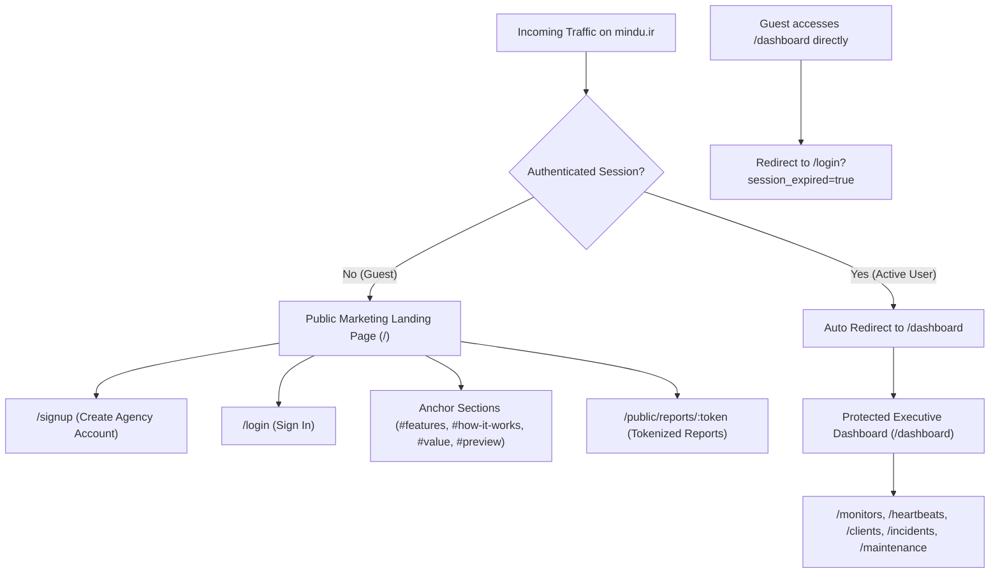

# TASK-010: Public Marketing Landing Page for mindu.ir — Implementation Report

**Project:** ClientPulse  
**Target Domain:** `mindu.ir`  
**Priority:** Critical — Public Product Presentation  
**Execution Environment:** Local Development Only  
**Status:** Successfully Completed & Verified  

---

## 1. Initial Route and Authentication Audit

Before making modifications, a full audit of `apps/web` and authentication mechanics was performed:

| Audit Question | Audit Findings |
|---|---|
| **1. Current root route `/` implementation** | Implemented as a single client component (`apps/web/src/app/page.tsx`) wrapping everything inside `<AppLayout>`. Unauthenticated visitors saw a minimal guest card with login/signup buttons, while authenticated users saw the Executive Dashboard. |
| **2. Did `/` render the authenticated dashboard?** | Yes, whenever a valid session cookie was present, `/` loaded the full Executive Dashboard with KPI cards, health status, and live widgets. |
| **3. Authentication & session detection mechanism** | Managed by `AuthProvider` in `src/lib/auth-context.tsx`. It initiates a probe call to `/api/v1/auth/me` on mount with `credentials: "include"`. On HTTP 401, if not on a public path, `clientpulse:session_expired` is fired to redirect users to `/login?session_expired=true`. |
| **4. Existing Sign In and Sign Up routes** | Sign In: `/login` (`apps/web/src/app/login/page.tsx`). Sign Up: `/signup` (`apps/web/src/app/signup/page.tsx`). Ancillary auth routes: `/forgot-password`, `/reset-password`, `/verify-email`. |
| **5. Application Shell application** | Provided via `<AppLayout>` (`src/components/AppLayout.tsx`), which renders the `#0f172a` dark desktop sidebar, top header (with workspace selector and user dropdown), and mobile drawer. |
| **6. Locale & RTL initialization** | Handled in `src/lib/i18n.tsx`. Synced via `localStorage.getItem("clientpulse_locale")`. An inline script in `<head>` sets `dir="rtl"` and `lang="fa"` synchronously before hydration to prevent layout flash. |
| **7. Brand tokens, logos, colors, fonts** | Inter (Latin) and Vazirmatn (Arabic/Persian) local woff2 fonts loaded in `src/lib/fonts.ts`. Color tokens `--brand-50`..`900`, `--surface-*`, `--status-*` declared in `globals.css` and `tailwind.config.ts`. Logo is a blue rounded square with an `Activity` pulse icon. |
| **8. Implemented & usable features today** | Website/API HTTP monitoring (GET/POST/HEAD, latency tracking, SSRF guard); Heartbeats for cron jobs (unique ping URLs, missed signal detection); Incident management lifecycle (open/acknowledged/resolved with audit history); Client & Asset registry; Maintenance activity logs; Multi-tenant workspace (RLS) & branded client care reports. |
| **9. Existing UI screenshots and components** | Actual operational components (`SystemHealthBar`, `PrimaryKpiCards`, `MonitorDistribution`, `ActiveIncidentsList`) exist in `src/components/dashboard/` and were adapted into high-fidelity authentic previews. |

---

## 2. Existing Root Route Behavior Before Implementation

Prior to TASK-010:
- Unauthenticated visitors hitting `http://localhost:3000/` were rendered inside `<AppLayout>`, meaning the application shell header was rendered around a small guest card.
- Authenticated users were routed to `/` for their dashboard, creating an architectural conflation between the public marketing surface and the private multi-tenant SaaS application.
- Navigation links across monitors, heartbeats, incidents, clients, and breadcrumbs directly linked to `/` as the dashboard.

---

## 3. Final Public and Authenticated Route Architecture

The route architecture was separated into clear public vs. protected boundaries:



### Route Table Summary

| Route | Access Level | Description | App Layout Shell? | API Call Behavior |
|---|---|---|---|---|
| `/` | Public | SaaS marketing landing page for `mindu.ir`. Redirects authenticated users to `/dashboard`. | **No** (Dedicated marketing header/footer) | **Zero** protected dashboard API calls. Only standard session probe. |
| `/dashboard` | Protected | Executive Dashboard with health status, KPI cards, and operational split view. | **Yes** (`<AppLayout>`) | Fetches `/api/v1/dashboard/stats`, incidents, heartbeats, etc. |
| `/login` | Public | Existing sign-in page. Post-login redirects to `/dashboard`. | Minimal guest header | Authenticates against `/api/v1/auth/login`. |
| `/signup` | Public | Existing agency registration page. Post-signup redirects to `/dashboard`. | Minimal guest header | Registers against `/api/v1/auth/signup`. |
| `/monitors`, `/heartbeats`, `/clients`, `/incidents`, `/maintenance` | Protected | Operational management pages. Breadcrumbs updated to `/dashboard`. | **Yes** (`<AppLayout>`) | Tenant-isolated operational endpoints. |
| `/robots.txt` & `/sitemap.xml` | Public | SEO crawler instructions and canonical indexing for `mindu.ir`. | N/A | Static generated endpoints. |

---

## 4. Landing Page Sections and Design Decisions

The landing page (`apps/web/src/app/page.tsx`) is composed of modular components:

### A. Navigation Header (`MarketingHeader.tsx`)
- **Brand Identity:** Product icon + "ClientPulse" wordmark + subtle `mindu.ir` domain pill.
- **Anchor Navigation:** Smooth-scrolling links to `#features`, `#how-it-works`, `#value`, `#preview`.
- **Language Switcher:** Interactive toggle for English (EN) and Persian (FA) backed by `useI18n()`.
- **CTAs:** Sign In link (`/login`) and prominent Sign Up button (`/signup`).
- **Responsive Drawer:** Off-canvas slide-in drawer on mobile (`< 1024px`), with full keyboard accessibility (`Escape` key listener, `aria-modal="true"`, focus restore).

### B. Hero Section (`HeroSection.tsx`)
- **Positioning Badge:** *"Purpose-Built for Web Agencies & Digital Teams"*.
- **Headline:** *"Stay Ahead of Every Client Website."* / *"همواره یک گام جلوتر از وب‌سایت‌های مشتریان باشید."*
- **Supporting Copy:** *"Monitor client websites and APIs, catch issues early, and keep every maintenance activity organized — all from one workspace."*
- **Primary CTAs:** Primary "Start Free with ClientPulse" (`/signup`) and Secondary "Explore Capabilities" (`#features`).
- **Engine Trust Strip:** Indicates PostgreSQL Queue Scheduler, 60s check intervals, and multi-layer SSRF guard.
- **Authentic Dashboard Preview:** A realistic browser frame mockup featuring the System Health Bar (*"All Systems Operational"*), 4 primary KPI cards (Monitored Targets, Targets Down, Open Incidents, Avg Latency), and live sample check rows.

### C. Product Capabilities Section (`CapabilitiesSection.tsx`)
Presents the 6 genuine capabilities in structured cards with Lucide icons and feature highlights:
1. **Website & API Monitoring:** HTTP/HTTPS checks (30s to 5m intervals), status validation, millisecond latency tracking, SSRF loopback guard.
2. **Cron & Worker Heartbeats:** Unique ping URLs, flexible intervals & grace windows, distinct missed heartbeat alerting.
3. **Incident Lifecycle Management:** Automated creation on outage, open -> ack -> resolved lifecycle, historical resolution notes.
4. **Client & Asset Organization:** Grouping websites/APIs by client organization, staging vs production environment classification.
5. **Maintenance Activity Logs:** Scheduled vs actual maintenance duration, audit trail to prove agency retainer value.
6. **Multi-Tenant Workspace & Care Reports:** PostgreSQL Row-Level Security (RLS), granular RBAC (Owner, Admin, Member, Viewer), tokenized public reports.

### D. How It Works Section (`HowItWorksSection.tsx`)
Four-step sequential agency workflow:
1. *Register Clients & Assets*
2. *Configure Checks & Pings*
3. *Real-Time Detection & Incidents*
4. *Deliver Care & Retainer Value*

### E. Agency Value Proposition (`AgencyValueSection.tsx`)
Focuses on web agency operational needs:
- **Portfolio Care:** Unified client management replacing scattered spreadsheets.
- **Client Trust:** Discover outages and broken SSL before clients complain.
- **Root Cause Clarity:** Distinguish background queue crashes from web server downtime.
- **Retainer Proof:** Transparent, documented maintenance records to justify recurring client fees.

### F. Product Preview Showcase (`ProductPreviewSection.tsx`)
An interactive tabbed interface showcasing authentic UI previews:
- *Executive Dashboard*
- *Monitors & Latency*
- *Worker Heartbeats*
- *Incident Lifecycle*
- *Client Management*

### G. Final Call to Action (`FinalCtaSection.tsx`)
High-impact dark slate gradient callout:
- *"Take Control of Your Client Websites."* / *"مدیریت و پایش وب‌سایت‌های مشتریان خود را متحول کنید."*
- Working buttons for `/signup` and `/login`.

### H. Footer (`MarketingFooter.tsx`)
- Brand statement, target domain note (`mindu.ir`), links to landing sections, account links, security architecture notes (SSRF guard, RLS), and simple copyright statement.
- Zero fabricated physical addresses, phone numbers, or fake legal links.

---

## 5. Implemented Features and Verification Matrix

Every marketing claim was cross-referenced against the repository:

| Feature Claimed on Landing Page | Corresponding Codebase Implementation | Verification Method |
|---|---|---|
| **Website & API Monitoring** | `services/api/internal/checker/`, `monitors` table | Verified by HTTP check tests & scheduler runs |
| **Heartbeat Ping Endpoints** | `/api/v1/ping/:secret`, `heartbeats` table | Verified in `task-004-e2e.js` and `task-008-b4-validation.js` |
| **Incident Lifecycle (Open/Ack/Resolve)** | `/api/v1/incidents/:id/acknowledge`, `/resolve` | Verified in `task-008-b3-1-validation.js` |
| **Multi-Tenant Client & Asset Registry** | `clients` & `assets` tables with `organization_id` | Verified in client management routes |
| **Maintenance Activity Tracking** | `maintenance_activities` table & API | Verified in `task-008-b4-validation.js` |
| **Tokenized Public Reports** | `/public/reports/:token`, `report_snapshots` | Verified in `task-005-e2e.js` |
| **SSRF Guard Protection** | `checker/ssrf.go` (IP range & loopback blocking) | Verified by SSRF rejection tests |
| **Bilingual EN/FA & RTL** | `apps/web/src/lib/i18n.tsx`, `dirScript` in `<head>` | Verified across all viewports in Playwright |

---

## 6. Bilingual EN/FA Translation and RTL Verification

- All marketing copy was added to both `translations.en` and `translations.fa` in `apps/web/src/lib/i18n.tsx`.
- Persian wording uses natural, professional terminology with correct نیم‌فاصله (ZWNJs) (e.g. `وب‌سایت‌ها`, `کرون‌جاب‌ها`, `حل‌شده`).
- Technical strings, URLs (`https://portal.acmeglobal.com`), HTTP codes (`HTTP 200`), and millisecond metrics (`42 ms`) preserve LTR formatting.
- When Persian is selected, `html[dir="rtl"]` activates the Vazirmatn font, inverts directional icons (`ArrowLeft` vs `ArrowRight`), mirrors flexbox layouts, and aligns text appropriately.
- Locale persistence across navigation was validated via `localStorage` and `useI18n`.

---

## 7. SEO Metadata Implementation

SEO metadata was configured in `apps/web/src/app/layout.tsx`:
- **Title:** `ClientPulse — Website Monitoring & Reliability Platform for Web Agencies | mindu.ir`
- **Description:** *"The dedicated website monitoring and client care platform for digital agencies. Monitor website availability, track cron heartbeats, manage incidents, and document client maintenance from one workspace."*
- **Canonical URL:** `https://mindu.ir`
- **OpenGraph & Twitter Card:** Configured for social sharing with appropriate metadata.
- **Robots Endpoint (`/robots.txt`):** Allows `/`, `/login`, `/signup`, `/public/reports/`; disallows protected routes (`/dashboard`, `/monitors`, `/heartbeats`, `/clients`, `/incidents`, `/maintenance`, `/reports`, `/settings`).
- **Sitemap Endpoint (`/sitemap.xml`):** Generates valid XML indexing `https://mindu.ir`, `https://mindu.ir/login`, and `https://mindu.ir/signup`.

---

## 8. Responsive Breakpoint Results

Tested using Playwright with strict horizontal overflow assertion (`scrollWidth <= innerWidth`):

| Viewport Width | Device Category | Scroll Width | Inner Width | Result |
|---|---|---|---|---|
| **1440px** | Standard Desktop | 1440px | 1440px | **PASS (Zero Overflow)** |
| **1024px** | Small Desktop / iPad Pro | 1024px | 1024px | **PASS (Zero Overflow)** |
| **768px** | Tablet Portrait | 768px | 768px | **PASS (Zero Overflow)** |
| **390px** | Standard Mobile (iPhone 14) | 390px | 390px | **PASS (Zero Overflow)** |
| **360px** | Narrow Mobile (Android Galaxy) | 360px | 360px | **PASS (Zero Overflow)** |

---

## 9. Sign Up and Sign In Flow Verification

Automated E2E tests verified:
1. Clicking **"Get Started"** or **"Start Free with ClientPulse"** navigates to `/signup`.
2. Registering an organization via `/signup` successfully creates the user, provisions the workspace in PostgreSQL, and smoothly navigates to `/dashboard`.
3. Clicking **"Sign In"** navigates to `/login`.
4. Successful login transitions the user to `/dashboard`.
5. An authenticated user attempting to visit `/` is smoothly redirected to `/dashboard`.
6. An unauthenticated guest attempting to access `/dashboard` directly is blocked and redirected to `/login?session_expired=true`.

---

## 10. Regression Test Results

Existing test suites were executed to verify zero operational regressions:

| Suite Name | Scope | Result |
|---|---|---|
| `task-010-landing-validation.js` | Public landing page isolation, SEO, breakpoints, mobile drawer, RTL, auth navigation, session guard | **PASS (7/7 Scenarios)** |
| `task-008-b4-validation.js` | Operational pages redesign, mobile viewports, Persian RTL, Viewer RBAC protection | **PASS (All Sections)** |
| `task-008-b3-1-validation.js` | Incident-aware dashboard, health bar precedence, legacy incident resolution fallbacks | **PASS (16/16 Scenarios)** |

---

## 11. TypeScript, ESLint, and Build Results

```bash
cd apps/web && npx tsc --noEmit && npm run lint
```
**Output:** 0 TypeScript errors, 0 ESLint warnings.

```bash
cd apps/web && npm run build
```
**Output:**
```
✓ Compiled successfully in 1771ms
✓ Finished TypeScript in 4.7s 
✓ Generating static pages using 11 workers (28/28) in 403ms

Route (app)
┌ ○ /
├ ○ /_not-found
├ ○ /assets
├ ƒ /assets/[id]
├ ƒ /assets/[id]/edit
├ ○ /assets/new
├ ○ /clients
├ ƒ /clients/[id]
├ ƒ /clients/[id]/edit
├ ○ /clients/new
├ ○ /dashboard
├ ○ /forgot-password
├ ○ /heartbeats
├ ƒ /heartbeats/[id]
├ ƒ /heartbeats/[id]/edit
├ ○ /heartbeats/new
├ ○ /incidents
├ ƒ /incidents/[id]
├ ○ /login
├ ○ /maintenance
├ ○ /monitors
├ ƒ /monitors/[id]
├ ƒ /monitors/[id]/edit
├ ○ /monitors/new
├ ○ /onboarding
├ ○ /organizations
├ ƒ /public/reports/[token]
├ ○ /reports
├ ƒ /reports/[id]
├ ○ /reset-password
├ ○ /robots.txt
├ ○ /settings/account
├ ○ /settings/branding
├ ○ /settings/members
├ ○ /settings/notifications
├ ○ /signup
├ ○ /sitemap.xml
└ ○ /verify-email
```

---

## 12. Screenshots Inventory

Saved in `task-report/screenshots/task-010/`:

| File Name | Resolution | Description |
|---|---|---|
| `01-en-desktop-fullpage.png` | 1440 x 5658 | Complete English desktop landing page from header to footer. |
| `02-en-desktop-hero.png` | 1440 x 900 | English desktop hero viewport with headline, CTAs, and dashboard mockup. |
| `03-en-mobile-390.png` | 390 x 8762 | English mobile full page at 390px showing responsive stacking. |
| `03-b-en-mobile-360.png` | 360 x 8908 | English narrow mobile full page at 360px with zero horizontal overflow. |
| `04-fa-desktop-fullpage.png` | 1440 x 5594 | Complete Persian (FA / RTL) desktop landing page with Vazirmatn typography. |
| `05-fa-mobile-390.png` | 390 x 8541 | Persian (FA / RTL) mobile full page at 390px. |
| `06-mobile-nav-drawer-open.png` | 390 x 844 | Open mobile navigation drawer with section links and auth actions. |
| `07-signup-route.png` | 1440 x 900 | Functional registration page reached via landing page Sign Up CTA. |
| `08-login-route.png` | 1440 x 900 | Functional login page reached via landing page Sign In CTA. |
| `09-authenticated-dashboard.png` | 1440 x 1595 | Authenticated Executive Dashboard at `/dashboard` after login. |

---

## 13. Known Limitations and Deferred Work

1. **Subscription & Pricing Table:** Explicitly deferred to the subsequent Platform Admin Panel task as instructed. No fabricated pricing tiers or trial promises were introduced.
2. **Customer Logos & Testimonials:** Deferred until real case studies are confirmed. No fake client logos, testimonial quotes, or unverified star ratings were added.
3. **Contact & Legal Pages:** Footer links to existing sections and authentication only. No fabricated physical addresses, phone numbers, or dummy legal agreements were created.

---

## 14. Explicit Confirmation of System Isolation

- **Production Deployment:** Strictly PROHIBITED and was NOT attempted.
- **Production Server / SSH / DNS / Caddy / Nginx:** UNTOUCHED.
- **Backend Go API & Worker (`services/api`):** UNTOUCHED.
- **Database Schema & Migrations (`migrations/`):** UNTOUCHED.
- **Docker Compose Production Configs:** UNTOUCHED.
- All modifications are strictly limited to the local web frontend (`apps/web`) and task reports.

