# TASK-UI-012 — Creative Direction & Award-Level Experience Proposal

**Project:** ClientPulse (`mindu.ir`)  
**Domain:** Enterprise Website & API Observability  
**Task ID:** TASK-UI-012  
**Date:** November 4, 2026  
**Document Status:** Approved & Selected for Implementation  

---

## 1. Executive Context & The Problem Statement

TASK-UI-011 introduced Three.js, GSAP ScrollTrigger, and basic interactive state management. However, its visual execution remained trapped in a conventional dark SaaS template pattern:
- A generic centered headline with small action buttons.
- A small, isolated 3D wireframe sphere floating in an arbitrary container.
- Repetitive 3-column rectangular card grids across multiple sections.
- Predictable scroll fade-ins with minimal spatial transformation.
- Lingering agency-exclusive marketing copy that contradicted the universal value proposition.

**TASK-UI-012 resets the creative direction entirely.** We are designing an award-level digital experience inspired by Lusion, Apple, Locomotive, Active Theory, and Awwwards Experimental Winners.

### Non-Negotiable Brand Positioning
- **Primary Brand Message:**  
  *“We Watch Your Websites. You Focus on What Matters.”*  
  *(Persian: «ما وب‌سایت‌های شما را می‌پاییم. شما بر آنچه مهم است تمرکز کنید.»)*
- **Universal Target:** Anyone who operates websites, online storefronts, microservices, or APIs (developers, founders, engineering leads, webmasters, and digital agencies).
- **Secondary Role for Agencies:** Client care retainers, multi-client workspace partitioning, and branded reporting are positioned as specialized secondary capabilities, not an exclusive gate.
- **Product Truth & Accuracy:** Zero simulated false promises regarding instant delivery or fictitious probe networks. All playground simulations are explicitly labeled as interactive demonstrations.

---

## 2. Creative References & Visual Techniques Researched

| Creative Reference | Key Technique Extracted | How We Adapt It for ClientPulse |
|---|---|---|
| **Lusion** (`lusion.co`) | Full-viewport reactive 3D spatial canvas with particle physics, dynamic mouse repulsion, and volumetric point lighting. | Transforming the Hero from a small boxed canvas into an expansive, interactive spatial universe with orbiting edge checker satellites, bezier data pulses, and camera perspective responsive to pointer coordinates. |
| **Apple AirPods / Mac Pro** (`apple.com`) | Scrubbed scroll choreography pinned in place, multi-element visual transformations tied to scroll progress rather than simple triggers. | Pinned 6-scene cinematic narrative where scrolling shifts the digital environment from tranquil operational green, to stressed amber latency degradation, to dramatic red alarm shockwave, to automated incident awareness, to healing recovery. |
| **Locomotive** (`locomotive.ca`) | Non-standard layout pacing, layered typography depth, overlapping transparent data layers, smooth momentum. | Breaking the repetitive 3-card grid into bespoke visual compositions for every section (e.g., interactive API request/response console, glowing heartbeat pulse oscillogram, dynamic incident timeline, maintenance scheduler). |
| **Active Theory** (`activetheory.net`) | Cyber-spatial HUD interfaces, glowing spline paths, tactical data telemetry, glowing glassmorphic panels. | Tactical observability cockpit aesthetic: glowing SVG waveforms, neon connection splines, real-time millisecond counters, and interactive playground sandbox. |

---

## 3. The Three Distinct Visual Concepts

### Concept A — "The Digital Universe" (Spatial Observability Mesh)
- **Visual Identity:** Expansive celestial cyber-space. Every website, API endpoint, edge probe, and database heartbeat is represented as an illuminated celestial node in a vast, interconnected digital cosmos.
- **Hero Composition:** Full-viewport interactive 3D WebGL cosmos with floating frosted glass HUD typography. The visitor can orbit the camera, hover nodes to reveal live ping frequencies, and watch data packets travel along glowing bezier curves.
- **Color & Lighting:** Deep obsidian void (`#030712`), deep space cobalt (`#0a192f`), neon cyan (`#00f5d4`), electric violet (`#8b5cf6`), and emerald beam lights (`#10b981`).
- **Scroll Behavior:** Smooth camera fly-through descending deeper into the spatial grid, passing through different monitoring constellations.
- **Feasibility & Performance:** High visual impact, but complex mobile adaptation and higher WebGL vertex load.

### Concept B — "The Cinematic Reliability Chronicle" (Directed Episodic Story)
- **Visual Identity:** Episodic cinematic product narrative. The entire landing page acts like a film reel exploring the life and death of a web service under stress, and the immediate peace of mind restored by ClientPulse.
- **Hero Composition:** High-drama cinematic letterbox composition with oversized bold typography, glowing core reactor mesh, floating edge satellites, and real-time millisecond counters.
- **Scroll Storytelling (Scenes 1–6):** Pinned scrubbed stage (`height: 400vh` scroll track) driving 6 distinct visual scenes:
  1. *Scene 01 · Connected:* Pristine emerald/cyan harmony, smooth bezier data flow, 34ms baseline.
  2. *Scene 02 · Monitoring Telemetry:* Distributed probes fire, dynamic SVG latency curves generate live.
  3. *Scene 03 · Degradation:* Scene lighting shifts to warning amber, visual connections jitter, latency spikes to 1,280ms.
  4. *Scene 04 · Catastrophic Failure:* Sudden red alert shockwave, connections sever, HTTP 502 Bad Gateway alarms burst onto screen.
  5. *Scene 05 · Incident Awareness:* Tactical HUD locks on, Incident `#INC-902` opens with automated audit log and multi-channel dispatch visualizer.
  6. *Scene 06 · Automated Recovery:* Soothing sapphire-emerald healing pulse, geometry re-aligns, resolution confirmed (Outage: 2m 14s), peace of mind restored.
- **Feasibility & Performance:** Highly achievable with GSAP ScrollTrigger + Three.js, lightweight GPU footprint, natural fallback for reduced motion, perfect mobile adaptation via interactive scene selector.

### Concept C — "Experimental Data Art & Precision Telemetry" (Editorial Cyber-Brutalism)
- **Visual Identity:** High-contrast Swiss graphic design meets brutalist radar telemetry. Monospace typography, ASCII readouts, live SVG oscilloscopes, and asymmetrical layouts.
- **Hero Composition:** Giant condensed typography spanning the viewport edge-to-edge, overlaid with interactive oscilloscope waveforms and raw JSON packet monitors.
- **Color & Lighting:** Pitch black (`#050505`), stark titanium white (`#f8fafc`), signal orange (`#ff5722`), radar green (`#00e676`), and mono amber (`#ffb300`).
- **Section Rhythm:** Horizontal split viewports, live waveform visualizers, dynamic cursor-following crosshairs.
- **Feasibility & Performance:** Extremely lightweight (minimal 3D), exceptional performance, but lacks the cinematic depth and emotional resonance of 3D spatial storytelling.

---

## 4. Concept Evaluation & Selected Art Direction

| Criteria | Concept A (Digital Universe) | Concept B (Cinematic Chronicle) | Concept C (Data Art) | **Selected Fused Direction (B+ / A)** |
|---|---|---|---|---|
| **Immediate "WOW" Hero** | Very High | Very High | Moderate | **Exceptional** |
| **Scroll Storytelling (Scenes 1–6)** | Moderate | Outstanding | Low | **Outstanding** |
| **Emotional Connection (Peace of Mind)** | Moderate | High | Moderate | **High** |
| **Section Diversity (No Card Grids)** | Moderate | High | Very High | **Very High** |
| **Mobile & Touch Usability** | Challenging | High | Very High | **High (Dedicated mobile controls)** |
| **Bilingual & RTL Harmony** | High | High | Moderate | **Complete Vazirmatn + LTR isolation** |
| **Performance & Resource Cleanup** | Moderate | High (60fps) | Very High | **High (Instanced buffers + cleanup)** |

### Winning Direction: The Fused Cinematic Chronicle ("Concept B+ with Spatial Hero")
We select **Concept B (The Cinematic Reliability Chronicle)** as the core narrative engine, elevated with **Concept A's immersive 3D spatial depth** in the Hero, and **Concept C's bespoke visual compositions** for each distinct section.

---

## 5. Architectural Blueprint for Implementation

```mermaid
flowchart TD
    subgraph LandingArchitecture["Award-Winning Landing Architecture"]
        Hero["1. Immersive 3D Spatial Hero (Full-width Three.js, glowing data streams, dual CTAs)"]
        Story["2. Pinned 6-Scene Cinematic Chronicle (GSAP ScrollTrigger scrub, ambient lighting shifts)"]
        Playground["3. Interactive Monitoring Playground (Simulated outage, latency spike, incident ack, recovery)"]
        
        subgraph BespokeSections["Bespoke Visual Sections (No Repetitive Grids)"]
            WebAPI["4. Website & API Observability Engine (Interactive probe request/response visualizer)"]
            Heartbeat["5. Worker & Cron Heartbeat Chamber (Animated pulse frequency oscillogram)"]
            Incident["6. Tactical Incident Command & Resolution Timeline (Audit log, status stepper)"]
            Agency["7. Client Portfolio & Care Retainers (Secondary agency workspace showcase)"]
            Preview["8. Interactive High-Fidelity Product Explorer (5 operational interfaces)"]
        end
        
        CTA["9. Cinematic Final Horizon CTA (Magnetic buttons, deep radial aura)"]
    end

    Hero --> Story
    Story --> Playground
    Playground --> BespokeSections
    BespokeSections --> CTA
```

### Specific Section Visual Innovations:
1. **Hero Experience:**
   - Full-width Three.js spatial canvas with 12 edge probe satellites, particle telemetry streams, glowing core node, interactive cursor parallax, and smooth camera zoom.
   - Clear brand messaging: *"We Watch Your Websites. You Focus on What Matters."*
   - Real registration CTA (`/signup`) with magnetic physics button.
2. **Pinned 6-Scene Story (`#story`):**
   - 6 fully realized cinematic scenes: Connected -> Active Monitoring -> Micro-Latency Degradation -> Total Outage -> Incident Awareness -> Automated Resolution.
   - Background lighting dynamically morphs between Emerald (`#10b981`), Amber (`#f59e0b`), Crimson (`#ef4444`), Violet (`#8b5cf6`), and Royal Blue (`#3b82f6`).
   - Scrubbed seamlessly via GSAP ScrollTrigger with zero scroll trapping, plus clickable stepper for direct navigation.
3. **Interactive Monitoring Playground (`#playground`):**
   - High-fidelity interactive laboratory allowing the visitor to select 3 distinct target types (API, Website, Worker Heartbeat).
   - Live interactive buttons: "Simulate Outage", "Acknowledge Incident", "Simulate Recovery", "Toggle Timeframe (1h, 24h, 7d)".
   - Dynamic SVG latency sparkline with millisecond jitter and animated incident drawer.
4. **Bespoke Sections (Zero Repetitive Grids):**
   - **Section 4 (HTTP & API Probes):** Interactive request inspector with live JSON response preview, SSL certificate expiry counter, and SSRF security shield.
   - **Section 5 (Heartbeat Monitoring):** Visual pulse oscillogram showing expected intervals, grace periods, and missed heartbeat alerts.
   - **Section 6 (Incident Commander):** Interactive incident timeline with official status transitions (`Open` -> `Acknowledged` -> `Resolved`) and audit notes.
   - **Section 7 (Agency Client Care):** Distinct secondary showcase explaining multi-tenant client organization and maintenance logs without dominating the page.
5. **Full Persian RTL & English Localization:**
   - Universal messaging in both English and Persian with Vazirmatn typography.
   - Complete LTR isolation for URLs, HTTP codes, and latency figures.
   - Responsive design verified from 360px up to ultrawide desktop.

