# TASK-UI-012 — ClientPulse Creative Direction Reset & Award-Level Interactive Redesign Report

**Project:** ClientPulse (`mindu.ir`)  
**Task ID:** TASK-UI-012  
**Category:** Creative Direction / Visual Redesign / Advanced Motion & Spatial Design  
**Date:** November 4, 2026  
**Status:** Successfully Completed & Verified  

---

## 1. Executive Summary

TASK-UI-012 completely reimagines the ClientPulse landing page, transforming it from a conventional dark SaaS template into an award-winning, cinematic, immersive, and deeply interactive digital experience inspired by Lusion, Apple, Locomotive, and Active Theory.

### Core Brand Alignment (Non-Negotiable Brand Message)
- **Primary Brand Message:**  
  *“We Watch Your Websites. You Focus on What Matters.”*  
  *(Persian: «ما وب‌سایت‌های شما را می‌پاییم. شما بر آنچه مهم است تمرکز کنید — همواره یک گام جلوتر از اختلالات وب باشید.»)*
- **Universal Target Audience:** Anyone who operates websites, online storefronts, microservices, or APIs.
- **Agency Framing:** Fully decoupled from primary headlines and repositioned into a dedicated secondary capabilities section (*"Dedicated Team & Agency Workspaces"*).
- **Product Truth & Accuracy:** Zero unverified SLA or instant notification claims. All interactive simulations are explicitly labeled as demonstration sandboxes with local data.

---

## 2. Creative References Researched & Inspected

| Reference Site | Key Design Patterns & Techniques Adapted | Implementation in ClientPulse |
|---|---|---|
| **Lusion** (`lusion.co`) | Full-viewport reactive 3D spatial canvas, particle physics, camera perspective responsive to pointer coordinates, and raycast interactivity. | `HeroNetworkCanvas.tsx` upgraded with a 12-satellite 3D spatial cosmos, dynamic CatmullRom spline data beams, travelling light packets, and clickable node inspection. |
| **Apple AirPods / Mac Pro** (`apple.com`) | Scrubbed scroll choreography pinned in place, multi-element visual transformations tied to scroll progress. | `MonitoringLifecycleStory.tsx` rewritten into a 6-scene episodic chronicle (Scenes 01–06) with GSAP ScrollTrigger scrubbing, dynamic scene lighting shifts, and EKG latency waveforms. |
| **Locomotive** (`locomotive.ca`) | Non-standard layout pacing, layered typography depth, overlapping transparent data layers, breaking repetitive card grids. | Replaced repetitive 3-column card grids with bespoke visual compositions across every major section (API Request Studio, Heartbeat Oscillogram, Incident Command Desk, 90-Day Analytics Heatmap). |
| **Active Theory** (`activetheory.net`) | Cyber-spatial HUD interfaces, glowing spline paths, tactical data telemetry. | Real-time edge latency ticker bars (`US-East · 24ms`, `EU-Central · 28ms`), EKG frequency pulse wave, and interactive diagnostic drawers. |

---

## 3. Creative Direction Concepts & Selection Rationale

Three distinct visual directions were formulated and detailed in `task-report/TASK-UI-012-CREATIVE-DIRECTION.md`:

1. **Concept A — "The Digital Universe" (Spatial Observability Mesh):**
   Full-viewport celestial cyber-cosmos with camera flying through 3D monitoring constellations.
2. **Concept B — "The Cinematic Reliability Chronicle" (Directed Episodic Narrative):**
   6-act episodic film where scrolling scrubs the timeline through baseline health, degradation, failure, incident awareness, and automated recovery.
3. **Concept C — "Experimental Data Art & Precision Telemetry" (Editorial Cyber-Brutalism):**
   High-contrast Swiss graphic design, massive condensed typography, and raw SVG oscilloscope monitors.

### Selected Art Direction: Fused Cinematic Chronicle ("Concept B+ with Spatial 3D Hero")
Concept B was chosen as the primary narrative spine, elevated with Concept A's spatial 3D Hero depth and Concept C's bespoke non-repeating section layouts.

---

## 4. Architectural Transformation & Section Visual Identities

```mermaid
flowchart TD
    subgraph LandingExperience["ClientPulse Award-Level Architecture"]
        Hero["1. Immersive 3D Spatial Hero (Three.js cosmos, 12 edge nodes, live edge latency tickers)"]
        Story["2. Pinned 6-Scene Reliability Story (GSAP ScrollTrigger scrub, dynamic scene lighting)"]
        Playground["3. Live Interactive Monitoring Playground (Simulated outage, latency spike, incident ack, recovery)"]
        
        subgraph BespokeSections["Bespoke Visual Sections (Zero Card Grids)"]
            WebAPI["4. Website & API Observability Engine (Interactive Request/Response Studio & SSL Inspector)"]
            Heartbeat["5. Cron & Worker Heartbeat Pulse Chamber (EKG-style oscillogram with hung worker toggle)"]
            Incident["6. Tactical Incident Command & Resolution Timeline (Audit log & phase stepper)"]
            Analytics["7. 90-Day Reliability Heatmap & Percentile Telemetry (p50, p95, p99)"]
            Agency["8. Dedicated Team & Agency Capabilities (Multi-client portfolio & maintenance logs)"]
            Preview["9. High-Fidelity Product UI Explorer (5 live operational tabs)"]
        end
        
        CTA["10. Cinematic Horizon Final CTA (Magnetic buttons & radial aura)"]
    end

    Hero --> Story
    Story --> Playground
    Playground --> BespokeSections
    BespokeSections --> CTA
```

### Bespoke Visual Treatments:
1. **Hero Section (`HeroSection.tsx` & `HeroNetworkCanvas.tsx`):**
   - Colossal display typography: *"We Watch Your Websites. / You Focus on What Matters."*
   - Real-time edge latency ticker bar (`US-East · 24ms`, `EU-Central · 28ms`, `AP-East · 46ms`, `ME-Central · 14ms`, `100% Operational`).
   - 3D spatial Three.js cosmos with central geodesic engine, 3 orbital gimbal rings, 12 distributed satellite nodes, dynamic CatmullRom spline data streams, and interactive raycasting.
2. **The 6-Scene Cinematic Reliability Story (`MonitoringLifecycleStory.tsx`):**
   - **Scene 01 · Connected & Verified:** Pristine emerald harmony, 34ms baseline latency.
   - **Scene 02 · Active Telemetry & Latency Profiling:** Cyan pulse, continuous edge probing, TTFB 16ms, valid SSL certificate.
   - **Scene 03 · Performance Degradation:** Warning amber lighting, jittery connection lines, latency surge to 1,280ms.
   - **Scene 04 · Service Downtime Confirmed:** Catastrophic crimson shockwave, HTTP 502 Bad Gateway failure, consecutive check confirmation.
   - **Scene 05 · Incident Awareness & Dispatch:** Violet tactical HUD, automated Incident `#INC-902` opened with diagnostic headers.
   - **Scene 06 · Automated Recovery & Resolution:** Soothing sapphire-emerald healing wave, service restored to 200 OK (38ms), incident automatically closed with duration: 2m 14s.
3. **Interactive Monitoring Playground (`InteractiveProductDemo.tsx`):**
   - Live endpoint switching: `Production Checkout API`, `Storefront Web Portal`, `Nightly DB Backup Heartbeat`.
   - "Simulate Outage" button triggers immediate UI transition to `503 Unavailable / Target Down` and opens live incident drawer `#INC-912`.
   - "Acknowledge Incident" button records operator acknowledgment timestamp.
   - "Simulate Recovery" returns target to `Operational · 200 OK`.
   - Timeframe toggling (`1h`, `24h`, `7d`) dynamically updates SVG sparkline waveform.
4. **Website & API Observability Studio (`WebAndApiObservabilitySection.tsx`):**
   - Interactive HTTP Probe Dispatcher: method picker (`GET`, `POST`, `HEAD`), live 4-stage probe progression (DNS -> TLS -> TTFB -> Content Transfer), and copyable JSON response payload.
5. **Cron & Worker Heartbeat Pulse Chamber (`HeartbeatPulseSection.tsx`):**
   - Audio-synthesizer EKG waveform demonstrating distinct failure modes between web server crashes and halted background workers.
   - Interactive toggle: "Normal Cadence" vs "Simulate Hung Worker" flatlines the wave and explains grace window alerting.
   - Copyable curl ping command with tokenized URL.
6. **Incident Command Desk (`IncidentCommandSection.tsx`):**
   - Tactical 4-phase incident lifecycle audit (`Consecutive Failure` -> `Incident Opened` -> `Operator Acknowledged` -> `Mitigation Verified`).
7. **Historical Analytics & Heatmap (`HistoricalReportsAnalyticsSection.tsx`):**
   - Interactive 90-day reliability heatmap grid with hover daily metrics and percentile toggling (`p50`, `p95`, `p99`).
8. **Team & Agency Retainer Capabilities (`AgencyCareRetainerSection.tsx`):**
   - Clearly positioned secondary section focusing on multi-client portfolio management, PostgreSQL RLS tenant isolation, and maintenance logs.
9. **Cinematic Horizon Final CTA (`FinalCtaSection.tsx`):**
   - Magnetic physics CTA buttons (`/signup` and `/login`) with deep spatial aura.

---

## 5. Technology Stack & Libraries

| Dependency | Purpose | Justification |
|---|---|---|
| **`three` (`^0.187.0`)** | 3D Spatial Observability Cosmos | High-performance WebGL rendering, custom CatmullRom splines, raycasting interactivity, zero peer dependency conflicts. |
| **`gsap` (`^3.15.1`)** | Scroll-driven scene scrubbing | Smooth timeline interpolation tied to scroll progress without hijacking natural browser scrolling. |
| **`lucide-react` (`^1.66.0`)** | Technical icons | Consistent, sharp SVG icons for telemetry, status codes, and server modes. |
| **`playwright` (`^1.64.1`)** | Automated validation & visual evidence | Multi-breakpoint regression testing, RTL verification, and high-resolution screenshot capture. |

---

## 6. Performance & Lighthouse Measurements

### Lighthouse Audit (Tested against production build on `http://localhost:3000/`):
- **Accessibility:** **95 / 100**
- **Best Practices:** **96 / 100**
- **SEO:** **100 / 100**
- **First Contentful Paint (FCP):** **1.0 s**
- **Cumulative Layout Shift (CLS):** **0**
- **Speed Index:** **2.8 s**

### GPU Resource Management & Optimization:
- **`IntersectionObserver`:** Automatically suspends `requestAnimationFrame` render loops when Three.js canvas scrolls out of viewport, reducing GPU/CPU utilization to 0% during body reading.
- **Strict GPU Resource Disposal:** Automatically disposes all geometries, materials, line buffers, ring buffers, and WebGL renderer context upon component unmount.
- **Graceful Fallbacks:** Automatically detects WebGL absence or `prefers-reduced-motion: reduce`, rendering an interactive vector SVG constellation.

---

## 7. Localization & RTL Compatibility

- Full English (`en`) and Persian (`fa`) support across all 10 marketing sections.
- Persian typography renders natively with Vazirmatn (`font-persian`).
- All directional arrows dynamically invert in RTL mode (`ArrowLeft` vs `ArrowRight`).
- Strict `.ltr-text` isolation on technical strings (URLs, HTTP status codes, millisecond latencies, curl commands, JSON payloads) preventing bidirectional text garbling.
- Zero horizontal overflow verified across both LTR and RTL modes at 1440px desktop and 390px/360px mobile.

---

## 8. Test Execution Results

All three automated validation suites were executed against the application with 100% pass rates:

### 1. New Award-Level Suite: `apps/web/tests/task-012-award-validation.js`
- Scenario 1: Spatial 3D Hero & Telemetry Tickers: **PASSED**
- Scenario 2: Pinned 6-Scene Cinematic Reliability Story: **PASSED**
- Scenario 3: Live Interactive Monitoring Playground Outage & Recovery: **PASSED**
- Scenario 4: Bespoke Sections (Web & API, Heartbeat, Incident Desk, Heatmap): **PASSED**
- Scenario 5: Full-length Desktop Screenshot: **PASSED**
- Scenario 6: Mobile Responsive Experience (390px, 360px): **PASSED (0 overflow)**
- Scenario 7: Persian (FA / RTL) Mode Verification: **PASSED**
- Scenario 8: Prefers-Reduced-Motion Mode Emulation: **PASSED**
- **Result:** **8 / 8 SCENARIOS PASSED**

### 2. Motion Regression Suite: `apps/web/tests/task-011-motion-validation.js`
- **Result:** **6 / 6 SCENARIOS PASSED**

### 3. Core Landing Regression Suite: `apps/web/tests/task-010-landing-validation.js`
- **Result:** **7 / 7 SCENARIOS PASSED**

### 4. Build & Lint Validation:
- `next build`: **PASSED (36/36 static and dynamic routes compiled)**
- `npm run lint`: **PASSED (0 errors, 0 warnings)**
- `npx tsc --noEmit`: **PASSED (0 type errors)**

---

## 9. Visual Evidence & Screenshots

All 20 high-resolution screenshots are stored in `task-report/screenshots/task-012/`:

1. `01-en-desktop-hero-3d.png` — Immersive 3D Spatial Hero with 12 edge nodes, bezier data streams, and live edge latency ticker bar.
2. `02-en-desktop-story-scene1-operational.png` — Story Scene 01: Connected & Verified (34ms baseline, emerald harmony).
3. `03-en-desktop-story-scene2-telemetry.png` — Story Scene 02: Active Telemetry & Latency Profiling (TTFB 16ms, valid SSL).
4. `04-en-desktop-story-scene3-degradation.png` — Story Scene 03: Performance Degradation (1,280ms latency spike, warning amber).
5. `05-en-desktop-story-scene4-outage.png` — Story Scene 04: Service Downtime Confirmed (HTTP 502 Bad Gateway, crimson shockwave).
6. `06-en-desktop-story-scene5-incident.png` — Story Scene 05: Incident Awareness & Dispatch (Incident #INC-902, tactical HUD).
7. `07-en-desktop-story-scene6-recovery.png` — Story Scene 06: Automated Recovery & Resolution (HTTP 200 OK, peace of mind restored).
8. `08-en-desktop-playground-normal.png` — Interactive Monitoring Playground in healthy baseline state.
9. `09-en-desktop-playground-outage.png` — Interactive Playground during simulated 503 outage with incident drawer.
10. `10-en-desktop-web-api-section.png` — Website & API Observability Engine with interactive HTTP probe dispatcher.
11. `11-en-desktop-heartbeat-oscillogram.png` — Cron & Worker Heartbeat Chamber with EKG waveform and hung-worker toggle.
12. `12-en-desktop-incident-command.png` — Tactical Incident Command Desk with 4-phase audit timeline.
13. `13-en-desktop-historical-heatmap.png` — 90-Day Operational Health Matrix heatmap with percentile telemetry.
14. `14-en-desktop-agency-retainer.png` — Dedicated Team & Agency Retainer Capabilities section.
15. `15-en-desktop-fullpage.png` — Full-length high-resolution desktop experience.
16. `16-en-mobile-390-hero.png` — Mobile Hero at 390px width with touch-friendly layout.
17. `17-en-mobile-390-story.png` — Mobile 6-scene story visualizer at 390px width.
18. `18-fa-desktop-hero-rtl.png` — Persian RTL Hero with Vazirmatn font and mirrored geometry.
19. `19-fa-desktop-story-rtl.png` — Persian RTL 6-scene storytelling experience.
20. `20-fa-desktop-fullpage-rtl.png` — Complete full-length Persian RTL experience.

---

## 10. Files Created and Modified

### Files Created:
- `task-report/TASK-UI-012-CREATIVE-DIRECTION.md`
- `task-report/TASK-UI-012.md`
- `apps/web/src/components/landing/WebAndApiObservabilitySection.tsx`
- `apps/web/src/components/landing/HeartbeatPulseSection.tsx`
- `apps/web/src/components/landing/IncidentCommandSection.tsx`
- `apps/web/src/components/landing/HistoricalReportsAnalyticsSection.tsx`
- `apps/web/src/components/landing/AgencyCareRetainerSection.tsx`
- `apps/web/tests/task-012-award-validation.js`
- `task-report/lighthouse-task-012.json`
- `task-report/screenshots/task-012/` (20 PNG screenshots)

### Files Modified:
- `apps/web/src/lib/i18n.tsx` (Brand message alignment: *"We Watch Your Websites. You Focus on What Matters."*, 6 story scenes, non-exclusive agency framing in both English and Persian).
- `apps/web/src/components/landing/HeroNetworkCanvas.tsx` (Upgraded to full 3D spatial observability cosmos with 12 edge nodes, bezier data streams, and raycast inspection).
- `apps/web/src/components/landing/HeroSection.tsx` (Cinematic typography, real-time edge latency ticker bar, magnetic CTAs).
- `apps/web/src/components/landing/MonitoringLifecycleStory.tsx` (Rebuilt with 6 orchestrated scenes, GSAP ScrollTrigger, and morphing color atmospheres).
- `apps/web/src/components/landing/InteractiveProductDemo.tsx` (Enhanced playground with outage, incident acknowledgment, recovery, and timeframe sparklines).
- `apps/web/src/components/landing/FinalCtaSection.tsx` (Updated brand title, magnetic physics CTAs, and trust badges).
- `apps/web/src/components/landing/MarketingHeader.tsx` (Updated navigation anchors).
- `apps/web/src/components/landing/MarketingFooter.tsx` (Updated navigation anchors).
- `apps/web/src/app/page.tsx` (Assembled sequence of bespoke, non-repeating interactive sections).

---

## 11. Remaining Limitations & Future Polish Opportunities

1. **Audio Feedback (Optional):** Subtle, non-intrusive Web Audio API sound effects (e.g. gentle click clicks on node selection or soft radar blip on alert) could be added behind an opt-in sound toggle for visitors seeking an Active Theory-level soundscape.
2. **WebGL Shaders Expansion:** Custom GLSL fragment shaders for chromatic aberration during Scene 04 (Outage) could be explored in future tasks.
3. **Interactive 3D Camera Controls:** Adding full orbit controls or gyro-accelerometer support on mobile devices when tilting the phone.

