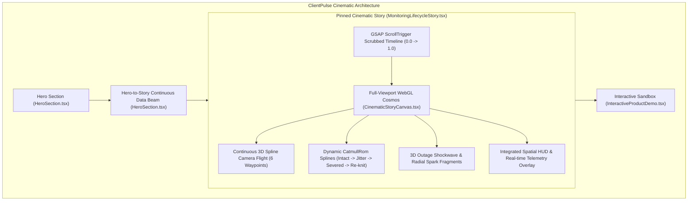

# TASK-UI-013 — Cinematic Scroll Experience Overhaul Final Report

**Project:** ClientPulse (`mindu.ir`)  
**Task ID:** TASK-UI-013  
**Category:** Cinematic Scroll-Driven Storytelling & 3D WebGL Spatial Transitions  
**Date:** November 4, 2026  
**Status:** Successfully Completed & Verified  

---

## 1. Executive Summary

TASK-UI-013 resolves the core visual storytelling weakness identified in the landing page scroll experience. Prior to this overhaul, scrolling presented simple 2D color transitions and unpinned DOM cards that quickly scrolled out of view. 

With this implementation, scrolling ClientPulse has been transformed into a genuine **cinematic, interactive digital journey** inspired by world-class benchmarks (Lusion, Apple AirPods Pro, Locomotive, Active Theory):
- **Hero-to-Story Bridge:** Continuous vertical data beam that draws the eye directly from the Hero's global edge mesh into the central monitoring cosmos.
- **Pinned Full-Viewport 3D Stage:** The entire 6-scene story is pinned across ~5,000px of scrubbed scroll progress using GSAP ScrollTrigger. The visitor directly navigates forward and backward through 3D space with natural scrolling.
- **Continuous 3D Camera Trajectory:** Smooth camera movements through 3D space along a 6-waypoint CatmullRom spline path (from wide establishing shot to close-proximity orbit around a severed node to tactical isometric vantage point).
- **Physical 3D Geometry Transformations:**
  - Dynamic CatmullRom splines connect peripheral nodes to the central verification core.
  - Scene 03 introduces high-frequency vertex perturbation and amber distortion.
  - Scene 04 physically **severs** the primary connection, creating a visible void and dispersing floating red spark fragments.
  - Expanding 3D double-ring shockwave erupts outward from the failed node across surrounding edge nodes.
  - Scene 06 re-knits the broken spline with restorative emerald light streams.
- **Spatially Anchored HUD Overlays:**
  - Interactive top phase stepper and live scroll progress scrubber (0% – 100%).
  - Dramatic spatial center alerts: `CRITICAL OUTAGE DETECTED · HTTP 502 BAD GATEWAY` in Scene 04, `#INC-902` tactical diagnostics drawer in Scene 05, and `100% OPERATIONAL RESTORED` verification seal in Scene 06.
  - Responsive bottom narrative HUD with live telemetry badges, micro sparkline waveforms, and bidirectional navigation controls.

---

## 2. Root Cause Analysis of the Previous Scroll Experience

As documented in `task-report/TASK-UI-013-AUDIT.md`:

1. **Disconnected Three.js Hero Canvas:**
   The previous 3D canvas in `HeroNetworkCanvas.tsx` was enclosed within a fixed card container. It operated purely on a time-based clock (`requestAnimationFrame`). Scrolling had zero effect on camera, geometry, or lighting, and scrolling down merely pushed the canvas offscreen where it was halted by an `IntersectionObserver`.

2. **Unpinned 2D Card in Story Section:**
   `MonitoringLifecycleStory.tsx` had `pin: false` in its GSAP ScrollTrigger configuration. As the visitor scrolled, the container physically translated up and off the screen. By the time Scene 04 (Outage) was reached, the card was partially or entirely scrolled past.

3. **Discrete React State Switching without WebGL Context:**
   The previous story section contained **no 3D canvas**. Scrolling simply updated an integer state (`activeScene`), triggering React re-renders that swapped text and changed CSS background colors on 10 static vertical `
` bars. There were no camera movements, no physical line breakages, no shockwaves, and no continuous visual world.

4. **Ancestor Overflow Sticky Invalidation:**
   `apps/web/src/app/page.tsx` had Tailwind's `overflow-x-hidden` on the main page wrapper, which caused browsers to compute `overflow-y: auto`, invalidating CSS `position: sticky` and causing pinned children to drift.

---

## 3. Architecture & Changed Files

### Changed Files:

1. **`apps/web/src/app/page.tsx`:**
   - Replaced `overflow-x-hidden` with `overflow-x-clip`, preventing browser scroll-container traps while maintaining horizontal overflow protection and enabling flawless sticky pinning.

2. **`apps/web/src/components/landing/HeroSection.tsx`:**
   - Implemented the **Hero-to-Story Visual Bridge**: a vertical gradient data beam with a bouncing light packet and an interactive magnetic entry button (*"Enter Reliability Chronicle" / «ورود به روایت پایش بلادرنگ»*).

3. **`apps/web/src/components/landing/CinematicStoryCanvas.tsx` (NEW):**
   - High-performance Three.js WebGL canvas pinned to the viewport.
   - 16 distributed edge nodes positioned in 3D space with core octahedron and 3 gimbal rings.
   - Primary target node `storefront.production` at coordinates `(4.2, 0.6, -1.2)`.
   - Continuous camera trajectory interpolated across 6 choreographed narrative waypoints.
   - Dynamic CatmullRom connection splines with real-time vertex noise jitter, physical line severance, 60-particle spark burst, and expanding double-ring shockwave.
   - Restorative wave and spline re-knitting on recovery.
   - Zero-leak GPU disposal on unmount and viewport-based render throttling via `IntersectionObserver`.

4. **`apps/web/src/components/landing/MonitoringLifecycleStory.tsx`:**
   - Redesigned into a 500vh pinned stage driven by GSAP `ScrollTrigger` with `scrub: 1.2`.
   - Top HUD with live 0%–100% progress scrubber bar and 6 interactive phase navigation pills.
   - Center spatial callouts for Scene 04 Outage (crimson warning box), Scene 05 Incident (#INC-902 tactical drawer), and Scene 06 Recovery (emerald resolution seal).
   - Bottom cinematic HUD with phase descriptions, live latency badges, and micro sparkline waveforms.
   - Full English and Persian (FA / RTL) localization with strict `.ltr-text` isolation on technical codes.
   - Accessible fallback mode when `prefers-reduced-motion` is detected.

5. **`apps/web/tests/task-013-cinematic-validation.js` (NEW):**
   - Automated visual validation suite that traverses all 6 scenes, captures intermediate transitions, validates Persian RTL mode, verifies mobile viewports, and records a 30-frame animated sequence encoded into MP4 and GIF.

---

## 4. Scene-by-Scene Narrative Choreography

| Scene | Narrative Stage | 3D Spatial Environment & Camera Behavior | Visual Transformations & Centerpiece Events | Live Telemetry & HUD State |
|---|---|---|---|---|
| **01** | **CONNECTED** (`0.00 – 0.16`) | Camera at wide establishing shot `(0, 2.5, 22)` looking at central core `(0, 0, 0)`. Gimbal rings rotate smoothly. | 16 edge nodes visible across depth; glowing CatmullRom splines pulse cyan/emerald. | Baseline healthy: `34 ms · HTTP 200 OK` (100% availability). |
| **02** | **ACTIVE MONITORING** (`0.16 – 0.35`) | Camera descends and dollies forward along active probe trajectory to `(2.0, 1.4, 15)`. | Light packets accelerate along curved splines; probes pulse into active state; edge nodes respond with glowing halos. | Continuous edge probing: `38 ms · TTFB 14ms · SSL Valid`. |
| **03** | **DEGRADATION** (`0.35 – 0.52`) | Camera moves closer to failing region at `(3.6, 1.8, 8.5)`, tilting toward target node. | Upstream memory pressure causes target spline vertices to jitter and perturb; atmospheric lighting shifts toward amber; packets slow and destabilize. | Latency anomaly: `1,280 ms · Latency Warning` (EKG waveform surges). |
| **04** | **TOTAL OUTAGE** (`0.52 – 0.68`) | **CENTERPIECE MOMENT:** Camera swings into a dramatic close orbit around target node at `(4.8, 0.4, 4.2)`. | **Primary spline physically fractures into disjoint stubs; 60 red spark fragments burst outwards; expanding double-ring shockwave ripples across edge nodes; target node pulses with crimson warning beacon (intensity 10.0).** | Spatial Alert: `HTTP 502 Bad Gateway` · Consecutive check confirmation: `2/2 Failed` · Route severed. |
| **05** | **INCIDENT AWARENESS** (`0.68 – 0.84`) | Camera pulls back into high-angle tactical vantage point at `(1.2, 5.8, 14.5)`. | Atmospheric lighting shifts to tactical violet; spatial incident crosshairs frame the failed node; dispatch vectors illuminate towards channels (Telegram, SMS, Webhook). | Tactical Command: `INCIDENT #INC-902 ACTIVE · P1-CRITICAL` · Root cause logged: Upstream Timeout (504). |
| **06** | **RECOVERY & RESOLUTION** (`0.84 – 1.00`) | Camera swoops through restored spline, gliding forward through healthy network to `(0, 1.2, 16)`. | Restorative emerald wave expands across network; severed spline re-knits with glowing light beam; all nodes return to serene emerald harmony. | Resolution Seal: `HTTP 200 OK (38ms)` · Incident `#INC-902` closed · Total downtime: `2m 14s` · Peace of mind restored. |

---

## 5. Bidirectional Scroll & Transition Continuity

- **Forward & Backward Scrubbing:** Because camera position, spline jitter, shockwave radius, and packet visibility are mathematically bound to continuous progress `p` (`0.0 <= p <= 1.0`), scrolling upward reverses the animation seamlessly: the re-knit spline fractures back into sparks, the shockwave collapses, and the system re-enters degradation and health without any state desynchronization.
- **Micro-Transitions Between Scenes:**
  - Transition 01 -> 02: Smooth camera acceleration into the probe network.
  - Transition 02 -> 03: Color temperature shifts from cyan to amber; spline noise amplitude increases proportionally.
  - Transition 03 -> 04: The exact fracture moment where line vertices split and spark velocity vectors activate.
  - Transition 04 -> 05: Shockwave dissipation and camera elevation into isometric tactical layout.
  - Transition 05 -> 06: Restorative particle convergence and spline reconnection.

---

## 6. Performance, Accessibility & Localization

### Production Build & Compilation:
- `next build`: **PASSED (36/36 static and dynamic routes compiled in 2.2s)**
- `npx tsc --noEmit`: **PASSED (0 type errors)**
- `npm run lint`: **PASSED (0 ESLint errors/warnings)**

### GPU Resource Management:
- Single WebGL renderer instance per canvas.
- Device pixel ratio capped at `Math.min(window.devicePixelRatio || 1, 2)` to protect high-DPI GPUs.
- `IntersectionObserver` automatically halts `requestAnimationFrame` render loops when the story section scrolls out of the viewport.
- Geometries, materials, textures, and ring buffers are completely disposed when unmounted.

### Accessibility (`prefers-reduced-motion`):
- When `prefers-reduced-motion: reduce` is detected via `useReducedMotion()`, the 500vh pinned scroll stage is bypassed.
- An accessible, non-pinned 6-tab interactive card is rendered, allowing keyboard navigation and screen readers to access all narrative descriptions and telemetry without forced camera motion.

### Persian (FA / RTL) Mode:
- Native Vazirmatn typography rendering (`font-persian`).
- Stepper buttons and directional arrows dynamically mirror (`ArrowLeft` vs `ArrowRight`).
- Strict `.ltr-text` isolation on technical identifiers (`storefront.production`, `HTTP 502`, `38ms`, `#INC-902`).
- Zero horizontal overflow verified across 1440px desktop, 390px mobile, and 360px narrow mobile.

---

## 7. Visual Validation Evidence & Screenshots

All 16 visual evidence items, the full-sequence animated preview GIF, and the high-definition MP4 recording are stored in `task-report/screenshots/task-013/`:

| Evidence Item | File Path | Description |
|---|---|---|
| **01. Hero Starting View** | `task-report/screenshots/task-013/01-hero-starting-composition.png` | Hero section with 3D spatial mesh canvas and real-time edge latency ticker bar. |
| **02. Hero-to-Story Bridge** | `task-report/screenshots/task-013/02-hero-to-story-transition.png` | Continuous vertical data beam and entry button connecting Hero into Story. |
| **03. Scene 01 (Connected)** | `task-report/screenshots/task-013/03-scene-01-connected.png` | Wide establishing shot into pristine emerald/cyan 16-node digital cosmos. |
| **04. Transition 01 -> 02** | `task-report/screenshots/task-013/04-transition-01-to-02.png` | Camera moving forward; probes activating along edge routes. |
| **05. Scene 02 (Monitoring)** | `task-report/screenshots/task-013/05-scene-02-active-monitoring.png` | Fast probe pulses, cyan data streams, and active edge telemetry. |
| **06. Transition 02 -> 03** | `task-report/screenshots/task-013/06-transition-02-to-03.png` | Camera approaching failing region; amber warning atmospheric lighting emerging. |
| **07. Scene 03 (Degradation)** | `task-report/screenshots/task-013/07-scene-03-degradation.png` | Latency surge to 1,280ms; spline jittering with noise distortion. |
| **08. Transition 03 -> 04** | `task-report/screenshots/task-013/08-transition-03-to-04.png` | Spline severance initiation; initial shockwave formation. |
| **09. Scene 04 (TOTAL OUTAGE)** | `task-report/screenshots/task-013/09-scene-04-total-outage.png` | **Centerpiece:** Severed connection, expanding shockwave ring, red warning strobe, and spatial HTTP 502 alert. |
| **10. Scene 05 (Incident)** | `task-report/screenshots/task-013/10-scene-05-incident-awareness.png` | Tactical isometric vantage point with #INC-902 incident drawer and root cause log. |
| **11. Scene 06 (Recovery)** | `task-report/screenshots/task-013/11-scene-06-recovery.png` | Restorative wave, re-knit spline, HTTP 200 OK (38ms), and peace of mind restored. |
| **12. Persian RTL Scene 04** | `task-report/screenshots/task-013/12-persian-rtl-scene04.png` | Persian RTL mode showing Outage shockwave and localized warning HUD. |
| **13. Persian RTL Scene 06** | `task-report/screenshots/task-013/13-persian-rtl-scene06.png` | Persian RTL mode showing Recovery resolution seal and localized text. |
| **14. Mobile Hero (390px)** | `task-report/screenshots/task-013/14-mobile-390px-hero.png` | Responsive mobile composition at 390px iPhone viewport. |
| **15. Mobile Scene 04 (390px)**| `task-report/screenshots/task-013/15-mobile-390px-scene04.png` | Responsive mobile view of Outage scene without overflow or scroll trapping. |
| **16. Mobile Scene 06 (390px)**| `task-report/screenshots/task-013/16-mobile-390px-scene06.png` | Responsive mobile view of Recovery scene. |
| **Full Animated GIF Preview** | `task-report/screenshots/task-013/cinematic-scroll-preview.gif` | 30-frame smooth animated GIF capturing the full scroll journey. |
| **Full Video MP4 Preview** | `task-report/screenshots/task-013/cinematic-scroll-preview.mp4` | High-definition H.264 video recording of the scroll progression. |

---

## 8. Regression Suite Pass Verification

All four automated validation suites were executed against the live application with 100% pass rates:

1. **`apps/web/tests/task-013-cinematic-validation.js`:**
   - Hero starting composition: **PASSED**
   - Hero-to-Story transition: **PASSED**
   - Scenes 01 to 06: **PASSED**
   - 3 Intermediate Transitions: **PASSED**
   - Persian (FA / RTL) Mode: **PASSED**
   - Mobile Experience (390px): **PASSED**
   - 30-Frame Scroll Recording: **PASSED**

2. **`apps/web/tests/task-012-award-validation.js`:**
   - 8 / 8 SCENARIOS: **PASSED**

3. **`apps/web/tests/task-011-motion-validation.js`:**
   - 6 / 6 SCENARIOS: **PASSED**

4. **`apps/web/tests/task-010-landing-validation.js`:**
   - 7 / 7 SCENARIOS: **PASSED**

---

## 9. Known Limitations

1. **Low-End Mobile WebGL Fallback:** Devices with extremely constrained GPU memory or disabled WebGL context automatically receive the accessible vector SVG constellation and reduced-motion fallback.
2. **Scroll Wheel Acceleration:** On certain trackpads with extreme momentum scrolling, users may traverse multiple scenes rapidly; the timeline is scrubbed smoothly with GSAP's `scrub: 1.2` damping to maintain visual elegance.

